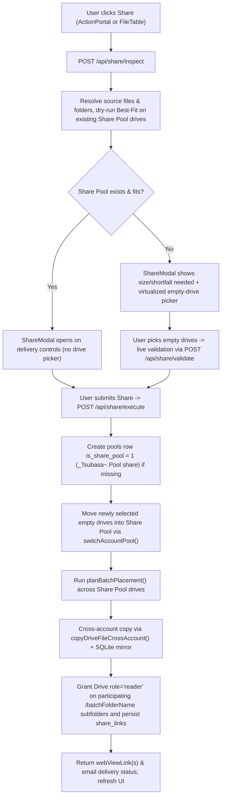

# Share Pool and Drive Link Sharing Plan

## 1. Overview and Constraints

Adds a **Share Pool** (`_Tsubasa~ Pool share`) and **Share via Drive** workflow so users can share individual files, multi-item selections, or virtual folders (including multi-account sets larger than 14.25 GB) via copyable Google Drive viewer links and Drive share notifications.

### Core rules and architectural constraints

- **Lazy Share Pool creation:** The Share Pool row (`name = 'Share Pool'`, `drive_folder_name = '_Tsubasa~ Pool share'`, `is_share_pool = 1`) does not exist by default and is created only on the first confirmed share (or cold recovery if `_Tsubasa~ Pool share` already exists in Drive).
- **Bottom pool ordering:** `GET /api/pools` returns `isSharePool` and orders `ORDER BY p.is_share_pool ASC, p.id ASC`; `Sidebar.tsx` and `MovePoolModal.tsx` sort regular pools before Share Pool.
- **Headroom reuse before expansion:** Subsequent shares reuse free headroom on existing Share Pool drives automatically. The empty-drive account selector renders only when the Share Pool does not exist yet or lacks enough space / per-file bin-packing capacity.
- **Empty-drive-only expansion:** Expansion lists zero-file accounts (`fileCount === 0`) across every pool with their current pool badge (`Pool 1`, `Pool 2`, `Share Pool`, etc.) and free headroom. Only accounts outside Share Pool that are authorized, enabled, and error-free can be toggled.
- **Snapshot copies under Best-Fit:** Selected Share Pool accounts receive independent server-side copies placed by `planBatchPlacement` (strict 750 MB safety reserve / 14.25 GB per-file ceiling). Original files in storage pools remain untouched.
- **Per-share batch subfolder viewer grants:** Each share creates a dedicated `/<batchFolderName>` subfolder inside `_Tsubasa~ Pool share` on participating Share Pool accounts and grants `role: 'reader'` on that batch subfolder rather than the pool root, limiting output links to one per participating drive per share batch and persisting them in `share_links`.
- **Quick Clear Share Pool:** Provides a confirmation modal and `Clear Share Pool` action deleting copied files, folders, and `share_links` rows inside `_Tsubasa~ Pool share` across Share Pool drives and SQLite without touching originals in other pools.
- **Layering invariants:** Pure backend modules (`quota.ts`, `placement.ts`, `share.ts`) import zero UI/DOM code, SQLite mutations run synchronously under `better-sqlite3` with `(pool_id, virtual_path)` uniqueness preserved, and frontend UI uses compile-time StyleX (`src/client/tokens.stylex.ts`), `@tanstack/react-virtual`, and WCAG AAA contrast with zero drop shadows.

---

## 2. End-to-End Architecture

---

## 3. Database Schema and Pool Management

- **Schema and startup migration (`src/server/db/schema.ts`, `src/server/db/init.ts`):**
  - Added `isSharePool: integer('is_share_pool', { mode: 'boolean' }).notNull().default(false)` on `pools` and added the `share_links` table (`pool_id`, `batch_folder_name`, `account_id`, `drive_folder_id`, `web_view_link`, `created_at`) with `share_links_pool_batch_account_idx` and `share_links_pool_batch_idx`.
  - `initDatabase()` creates `is_share_pool` and `share_links` on fresh databases and checks `PRAGMA table_info(pools)` to run `ALTER TABLE pools ADD COLUMN is_share_pool INTEGER NOT NULL DEFAULT 0` on existing databases. Initial seeding stays strictly at Pool 1 (`id = 1`).
  - Startup migration moves any legacy Share Pool row (`is_share_pool = 1 AND id < 1_000_000`) to `SHARE_POOL_RESERVE_ID` (`1_000_000`), rewriting `accounts.pool_id`, `share_links.pool_id`, `files.pool_id`, `files.folder_id`, `folders.id`, `folders.parent_folder_id`, and `folders.pool_id` inside one transaction.
- **Pool allocation and read-only rules (`src/server/drive/client.ts`, `src/server/app.ts`):**
  - `ensureSharePoolExistsInDb()` allocates `Math.max(SHARE_POOL_RESERVE_ID, maxId + 1)` so Share Pool stays at `1_000_000`. `POST /api/pools` computes `MAX(id) + 1` filtering `WHERE is_share_pool = 0`, so creating a new pool after `Pool 1` and `Share Pool` produces `Pool 2` (`_Tsubasa~ Pool 2`) instead of jumping to `Pool 3`.
  - `GET /api/pools` selects `p.is_share_pool as isSharePool` and orders `ORDER BY p.is_share_pool ASC, p.id ASC`.
  - `PATCH /api/pools/:id` and `DELETE /api/pools/:id` block renaming or deleting Share Pool once created (`403 SHARE_POOL_PROTECTED`).

---

## 4. Drive Client and Storage Engine

- **`src/server/drive/client.ts`:**
  - Exports `SHARE_POOL_FOLDER_NAME = '_Tsubasa~ Pool share'`, `resolvePoolDriveFolderName(poolId)`, `parsePoolFolderDescriptor(name)`, and `ensureSharePoolExistsInDb()`.
  - `ensureRootFolder(drive, preferredPoolId)` recognizes `_Tsubasa~ Pool share` via `parsePoolFolderDescriptor` during cold recovery and attaches recovered accounts to `ensureSharePoolExistsInDb()`, while new accounts without existing folders still default to `preferredPoolId = 1`.
  - `switchAccountPool(accountId, targetPoolId)` uses `resolvePoolDriveFolderName(targetPoolId)` when renaming `rootFolderId` and recreates the folder via `ensureRootFolder` if `rootFolderId` is null.
- **`src/server/storage/quota.ts`:**
  - Exports `EmptyShareAccount` and `getEmptyAccountsAcrossAllPools(nowMs, authorizedAccountIds?)` returning all zero-file accounts across all pools ordered by `pools.isSharePool ASC, pools.id ASC, accounts.email ASC`, including current pool metadata, headroom, 24h transfer stats (via bulk windowed queries), disabled state, and OAuth authorization status without importing `authPool`.
- **`src/server/storage/placement.ts`:**
  - Adds optional `allowedAccountIds?: Set<string>` to `getEligibleAccounts`, `selectPlacementForFile`, and `planBatchPlacement`.
  - Extracts `simulateBatchPlacement(items, candidates, poolId)` for dry-run placement checks against explicit candidate sets without mutating SQLite or Drive.

---

## 5. Share Engine and Hono RPC Contracts

### `src/server/drive/share.ts`

1. `resolveShareTargets(sourcePoolId, items)`: resolves non-trashed files and recursive descendant files/folders under `sourcePoolId`, deduplicates files, checks `MAX_SINGLE_FILE_BYTES`, strips common parent prefixes, and deduplicates colliding `(sharePoolId, virtual_path)` targets on repeat shares.
2. `inspectSharePlan(sourcePoolId, items)`: returns `ShareInspectPlan`, running `simulateBatchPlacement` on active Share Pool drives if present (`sharePoolFitsWithoutExpansion`, `existingSharePoolHeadroomBytes`, `shortfallBytes`) and loading `emptyAccounts`.
3. `validateShareSelection(sourcePoolId, items, selectedAccountIds)`: validates selected expansion accounts are zero-file, enabled, and authorized, merges them with active Share Pool drives, and runs `simulateBatchPlacement` to return `ShareValidationResult`.
4. `executeShare(params)`: validates inputs, lazily creates Share Pool via `ensureSharePoolExistsInDb()`, moves newly selected empty accounts via `switchAccountPool`, runs `planBatchPlacement`, mirrors folder trees under `/<batchFolderName>` (`ensureRemoteFolderHierarchy` + `ensureLocalFolderHierarchy`), copies files (`copyDriveFileCrossAccount` + `appProperties`), updates SQLite (`files`, `accounts.quotaUsedBytes`, `transfer_logs`), grants `role: 'reader'` on each participating `/<batchFolderName>` subfolder (`type: 'anyone'` plus optional `type: 'user'` with `sendNotificationEmail: true` and `emailMessage`), and persists the resulting links in `share_links`.
5. `clearSharePool(sharePoolId)`: verifies `is_share_pool = 1`, removes remote contents inside each Share Pool account's `_Tsubasa~ Pool share` root folder (logging warnings if offline), deletes `files`, `folders`, and `share_links` rows for `sharePoolId`, and reconciles `accounts.quotaUsedBytes`.
6. `listSharePoolLinks(sharePoolId)`: returns persisted `share_links` rows joined with account email ordered by `created_at DESC`.

### Hono routes (`src/server/app.ts`)

| Endpoint | Request body | Response shape |
| :--- | :--- | :--- |
| `POST /api/share/inspect` | `{ sourcePoolId, items }` | `ShareInspectPlan` (`sharePoolExists`, `sharePoolFitsWithoutExpansion`, `existingSharePoolHeadroomBytes`, `shortfallBytes`, `totalBytes`, `fileCount`, `folderCount`, `overCeilingFiles`, `emptyAccounts`, ...) |
| `POST /api/share/validate` | `{ sourcePoolId, items, selectedAccountIds }` | `ShareValidationResult` (`valid`, `reason?`, `totalAvailableHeadroomBytes`, `requiredBytes`, `accountAllocations?`) |
| `POST /api/share/execute` | `{ sourcePoolId, items, selectedAccountIds, recipientEmails, emailMessage? }` | `ExecuteShareResult` (`sharePoolId`, `batchFolderName`, `totalBytes`, `fileCount`, `folderCount`, `links`, `emailDeliveries`) |
| `GET /api/share/links` | Query `?poolId=` | `{ sharePoolId, links }` |
| `POST /api/pools/:id/clear-share` | None (`:id` param) | `ClearSharePoolResult` (`sharePoolId`, `filesRemoved`, `foldersRemoved`, `bytesReclaimed`, `warnings`) |

Read-only enforcement in `src/server/app.ts` uses `isSharePoolId()`, `isAccountInSharePool()`, and `sharePoolReadOnlyError()` to reject (`403 SHARE_POOL_READ_ONLY`) uploads (`/api/files/upload/session`, `/api/files/upload`), folder creation (`POST /api/folders`), item moves/copies/renames (`/api/items/*`), OAuth credential imports/hydrations (`/api/accounts/oauth/import`, `/api/accounts/hydrate/:id`), Drive change syncs and discrepancy resolutions (`/api/sync/all`, `/api/sync/:id`, `/api/sync/:id/cold`, `/api/sync/external-changes/:accountId`, `/api/sync/resolve/*`), cross-drive rebalances (`/api/sync/rebalance/*`), and sharing out of Share Pool (`/api/share/*`).

---

## 6. Frontend UI and StyleX Mapping

- **Tokens:** Flat `colors.surface` / `colors.surfaceAlt` containers with `1px solid colors.border` / `colors.borderSubtle` (no drop shadows), `tabular-nums` sizes, `colors.accentGold` primary controls, `colors.successSurface` / `colors.success` copy states, and `colors.dangerSurface` / `colors.danger` warnings.
- **Entry points, read-only Share Pool scoping, and file badges:**
  - `Icons.tsx`: `IconShare`, `IconLink`, `IconMail`.
  - `src/client/components/RedactedEmail.tsx` & `src/client/utils/format.ts`: exports `maskEmail(email)` and `<RedactedEmail />` used by both `Sidebar.tsx` and `FileTable.tsx` so account emails and file `accountPill` badges mask emails while preserving copy-on-select and ellipsized truncation inside the `140px` `Account` column (`overflow: 'hidden'` on `accountCell`, `display: 'inline-block'`, `maxWidth: '100%'` on `accountPill`).
  - `Sidebar.tsx` & `MovePoolModal.tsx`: `sortPools()` keeps Share Pool at the bottom of pool dropdowns; `+ New` pool remains standard-only. When viewing Share Pool, `Sidebar.tsx` hides pool rename, pool delete, `Add account`, account `Changes`, and `All files` drag-drop targets.
  - `ActionPortal.tsx` & `FileTable.tsx`: adds `Share` in active selection bar and row actions on standard pools (`!isTrashView && !isSharePoolActive`), plus `Clear Share Pool` on Share Pool. When `isSharePoolActive`, `ActionPortal.tsx` and `FileTable.tsx` hide upload, drag-drop, new folder, fetch changes, rename, cut/copy/paste, batch-move account pills, per-row transfer dropdowns, and Share buttons while keeping browse, download, trash/delete, and clear.
  - `ConfirmPurgeModal.tsx`: supports `mode="share_pool"` warning copy clarifying that Share Pool copies are permanently deleted while originals in other pools stay untouched.
- **`ShareModal.tsx`:**
  - Step 1 shows item summary card, 14.25 GB ceiling guard, conditional headroom banner (when `sharePoolFitsWithoutExpansion`) or virtualized (`@tanstack/react-virtual`) cross-pool empty-drive selector with `Auto-select`, capacity meter, pool badges, and neutral `'Already included'` badge for empty Share Pool drives. Live `/api/share/validate` gates `allocationReady` without shifting modal layout on partial drive selection. Delivery controls include optional recipient email chips and optional message note (viewer links are always generated for each participating `/<batchFolderName>` subfolder).
  - Step 2 displays read-only monospace `webViewLink` cards per participating Share Pool account (`Copy link` / `Copy all links`) and per-recipient `Sent via Drive` / error badges.
- **`App.tsx`:** Wires `activePool`, `isSharePoolActive`, `shareTargetItems`, `isClearSharePoolOpen`, `ShareModal`, and `ConfirmPurgeModal` (`mode="share_pool"`), guards mutating handlers and keyboard shortcuts (`F2`, `Ctrl+X`, `Ctrl+C`, `Ctrl+V`, window `dragover`/`drop`) when `isSharePoolActive`, and clears stale rename/move modals on pool switch.

---

## 7. Implementation Slices

- **Slice 1 (Database, Drive client, and storage engine):** `schema.ts`, `init.ts`, `client.ts`, `quota.ts`, `placement.ts`
  - [x] Add `isSharePool` schema column, `initDatabase` column migration, and legacy `< 1_000_000` Share Pool ID migration.
  - [x] Support `SHARE_POOL_RESERVE_ID = 1_000_000`, `_Tsubasa~ Pool share` discovery/naming, and `switchAccountPool` in `client.ts`.
  - [x] Add `getEmptyAccountsAcrossAllPools` in `quota.ts`.
  - [x] Add `allowedAccountIds` filtering and `simulateBatchPlacement` in `placement.ts`.
- **Slice 2 (Backend Share engine and Hono routes):** `src/server/drive/share.ts`, `src/server/app.ts`
  - [x] Implement `src/server/drive/share.ts`.
  - [x] Fix `POST /api/pools` standard numbering (`WHERE is_share_pool = 0`), enforce Share Pool read-only/protected guards, and add `/api/share/*` and `/api/pools/:id/clear-share` routes in `src/server/app.ts`.
- **Slice 3A (Icons, badges, dropdown ordering, purge modal, and read-only Share Pool UI):** `format.ts`, `Icons.tsx`, `Sidebar.tsx`, `MovePoolModal.tsx`, `ConfirmPurgeModal.tsx`, `ActionPortal.tsx`, `FileTable.tsx`
  - [x] Export shared `maskEmail` and censor/ellipse `accountPill` badges inside `FileTable.tsx`.
  - [x] Enforce bottom Share Pool ordering and read-only Share Pool scoping in `Sidebar.tsx`, `ActionPortal.tsx`, and `FileTable.tsx`.
  - [x] Add `share_pool` confirmation mode to `ConfirmPurgeModal.tsx`.
- **Slice 3B (`ShareModal` and `App` wiring):** `src/client/components/ShareModal.tsx`, `src/client/App.tsx`
  - [x] Build `src/client/components/ShareModal.tsx`.
  - [x] Wire share, clear-share-pool, and Share Pool read-only guards/shortcuts in `src/client/App.tsx`.

---

## 8. Verification and audit status

- **Full build check.** `npm run build` exited with code `0` across `tsc --noEmit`, `vite build` transforming `66 modules` into `dist/assets/stylex.css` at `18.34 kB` and `dist/assets/index-D6aJxJRi.js` at `647.61 kB`, and `tsc -p tsconfig.server.json`.
- **Isolated post-remediation runtime checks.** Running the scratch verification harness against a temporary `TSUBASA_DB_PATH` SQLite database passed every assertion.
  - `initializeDatabase()` migrated a legacy Share Pool with `id = 3` along with its `accounts`, `folders`, `files`, and `share_links` rows to `1_000_000`, and `listSharePoolLinks(1_000_000)` returned the migrated link with zero rows remaining on `pool_id = 3`.
  - `getEmptyAccountsAcrossAllPools()` aggregated 24-hour upload and download stats from `transfer_logs` without importing `authPool` and honored the optional `authorizedAccountIds` set.
  - `POST /api/accounts/oauth/import`, `POST /api/accounts/hydrate/:id` by query `poolId` and by Share Pool `accountId`, `GET /api/sync/external-changes/:accountId`, `POST /api/sync/resolve/accept`, `POST /api/sync/resolve/move-to-root`, and `POST /api/sync/resolve/remove-missing` returned `403 SHARE_POOL_READ_ONLY`.
  - `PATCH /api/pools/1` returned `200` and renamed Pool 1.
  - `sortPools()` ordered regular pools before `isSharePool` pools, and `maskEmail()` masked middle address characters.
- **Unverified live runtime paths.** Browser visual checks and live Google Drive OAuth calls such as `executeShare`, `copyDriveFileCrossAccount`, `drive.permissions.create` with `sendNotificationEmail: true`, and remote Drive deletions in `clearSharePool` have not run against live accounts in this workspace.
