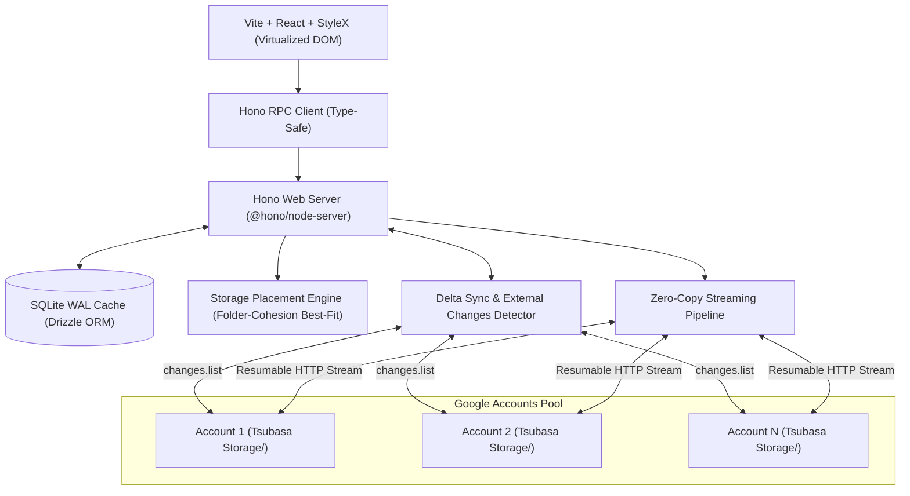
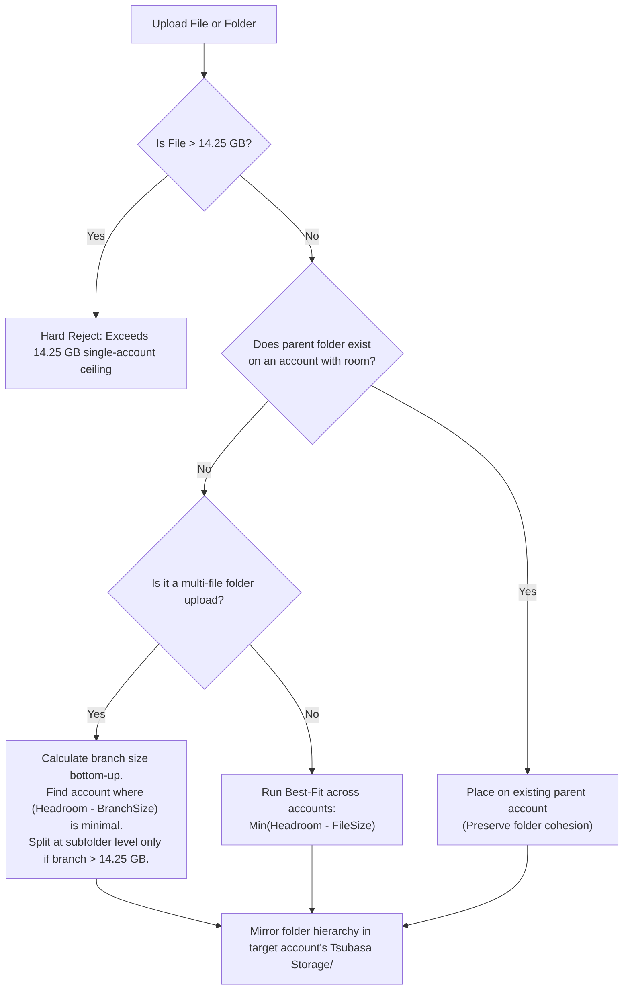
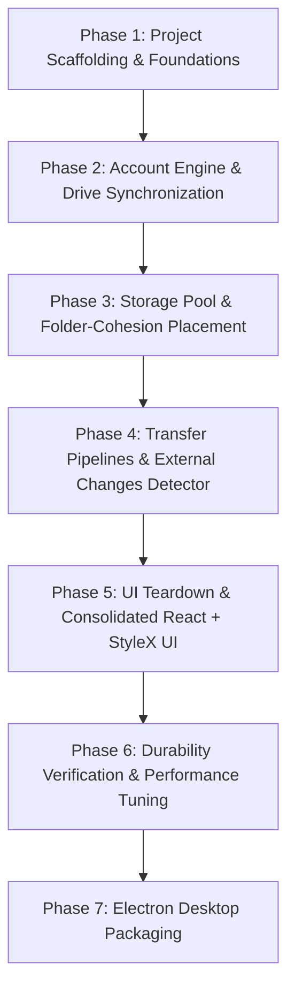

# Tsubasa technical roadmap

## 1. Executive summary

Tsubasa pools multiple personal Google accounts into a single, high-performance virtual storage drive. It provides a centralized web and desktop interface for managing files across accounts, while keeping files intact without striping or splitting. 

The system operates on a **local-first, zero-latency architecture**: all navigation, search, and directory manipulation query an indexed local SQLite cache, eliminating network latency and keeping Google API calls to the absolute minimum.



---

## 2. Technology stack and architectural components

| Component | Choice | Purpose |
| :--- | :--- | :--- |
| **Frontend framework** | React 19, TypeScript | Reactive state management, virtualized file trees, native component model. |
| **Styling engine** | StyleX | Compile-time atomic CSS-in-JS by Meta. Zero runtime overhead, full type safety, predictable styles. |
| **Design teardown** | REA + Chrome CDP | Reverse engineer layout, spacing, and component patterns from Google Drive, Dropbox, and Mega. |
| **Build system** | Vite | Instant HMR, optimized bundling, drop-in compatibility with Electron renderers. |
| **Backend API** | Hono (`@hono/node-server`) | Web-standard `Fetch`/`Request`/`ReadableStream` APIs, zero dependencies, built-in end-to-end RPC typing. |
| **Local database** | SQLite (via `better-sqlite3` and Drizzle ORM) | High-speed local index cache, sub-millisecond lookups, ACID transactions, zero cloud fees. |
| **Remote metadata** | Google Drive `appProperties` | Durable, self-describing file attributes stored on Google servers for cold-start recovery. |
| **Google auth model** | Desktop app OAuth client (`installed`) | Uses loopback redirect without requiring manual redirect URI configuration in Google Cloud Console. Single client authorizes multiple pooled accounts. |
| **Packaging** | Electron (Phase 7) | Wraps the local Hono server and Vite frontend into a desktop application. |

---

## 3. Performance and latency directives

To maintain responsiveness comparable to native desktop applications, the architecture enforces five performance rules:

1. **Local-first read path.** 
   The frontend never calls Google Drive to list files, expand directories, or run searches. 100% of read operations hit indexed local SQLite tables, returning in under 2 milliseconds.
2. **Zero-copy streaming pipeline.**
   Uploads and downloads stream directly through Hono without buffering complete files in memory or writing temporary files to local disk. Memory overhead remains under 50 MB even during 14 GB transfers.
3. **Instant virtual operations with lazy sync.**
   Folder renames, virtual file moves, and path updates apply instantly to SQLite. The UI reflects changes immediately, while background tasks update Google Drive `appProperties` asynchronously.
4. **Incremental delta synchronization.**
   Tsubasa avoids repeated tree crawls. After initial account initialization, synchronization uses Google Drive's `changes.list` API with stored page tokens, fetching only modified records in a single payload.
5. **Constant-time DOM rendering.**
   Large directories with tens of thousands of items are rendered using viewport virtualization (TanStack Virtual). The DOM node count remains constant regardless of folder size.

---

## 4. Quota, allocation, and storage mechanics

### 4.1 Headroom and safety buffer
* **Ceiling per account:** 14.25 GB maximum allocation on free 15 GB accounts.
* **Safety reserve:** 750 MB is strictly reserved to protect Gmail, Google Photos, and system metadata from bouncing incoming mail.
* **Dynamic calculation:**
  $$\text{Headroom}_i = \max(0, \text{limit}_i - 750\text{ MB} - \text{usage}_i)$$
* **System storage accounting:** Backup snapshots, database mirrors, and manifest files stored in Drive are included in both individual account meters and the global storage tally.

### 4.2 Placement engine: Folder-Cohesion Best-Fit
To keep files organized and easily browsable directly inside `drive.google.com`, Tsubasa uses **Path Affinity** rather than scattering sibling files across random accounts.



1. **Upload limit (Hard reject):** Any single file exceeding 14.25 GB is rejected immediately at the frontend with an informative size limit dialog.
2. **Folder affinity (Existing path priority):** If a parent directory (like `/Projects/2026/`) already holds files on Account A and Account A has enough headroom, the file is placed on Account A.
3. **Bottom-up branch sizing (Directory uploads):** When uploading a folder hierarchy, Tsubasa computes the total size of the deepest subfolders first. The placement engine fits whole subfolders into the account with the best fit. A directory is split at subfolder boundaries only if its total size exceeds an account's headroom.
4. **Physical folder mirroring:** Inside each account's `Tsubasa Storage/`, Tsubasa recreates the directory path so browsing via Google Drive's web UI remains structured and legible.

### 4.3 Transfer limit monitoring
* Google enforces a strict upload limit of 750 GB per rolling 24-hour window per account.
* SQLite maintains a rolling `transfer_logs` ledger recording every upload timestamp and size. The UI surfaces live 24-hour transfer gauges per account to prevent hitting Google rate caps.

### 4.4 Defensive lifecycle management
* **Soft delete:** Deleting a file marks it as trashed in SQLite and issues an update to Google Drive (`trashed: true`). The file remains recoverable in the Google Drive trash.
* **Empty trash:** Quota is permanently reclaimed only when the user explicitly triggers "Empty Trash" through a confirmed action.

### 4.5 External modification detection and over-ceiling handling
Users may occasionally edit, move, or delete files directly inside `drive.google.com`.

* **Detection:** Periodic or on-demand delta sync via `drive.changes.list` flags discrepancies between Google Drive and the local SQLite index.
* **Over-ceiling files ($> 14.25\text{ GB}$ detected in `Tsubasa Storage/`):**
  When a file between 14.25 GB and 15 GB is found in `Tsubasa Storage/`, the UI presents two sequential options:
  1. **Accept into Tsubasa (Over-ceiling mode):** Indexes the file into Tsubasa. The account headroom immediately drops to 0 GB (locked to read-only for new writes). The account card displays a high-priority alert: *"Buffer breached (e.g. 14.6 / 15.0 GB). Incoming emails may fail."*
  2. **Move to root (Eject outside Tsubasa):** Moves the file from `Tsubasa Storage/` out to `My Drive` root via `files.update` (takes 0 extra bytes). Tsubasa removes it from its SQLite index and treats the space as external non-Tsubasa usage.
* **Standard external change actions:**
  1. **Accept changes:** Updates SQLite paths, file sizes, and checksums to match the new Drive state.
  2. **Rebuild index:** Scans all account folders to reconstruct the entire virtual tree from scratch.
  3. **Auto-rebalance:** If files added directly in `drive.google.com` push an account beyond its 14.25 GB ceiling, a rebalance action moves Tsubasa-managed files to an emptier account using Google's cloud-to-cloud server-side copy.

### 4.6 Cold recovery without cloud databases
* Every file uploaded by Tsubasa carries identifying metadata in Google Drive:
  ```json
  {
    "tsubasa_managed": "true",
    "tsubasa_virtual_path": "/Backups/archive.tar.gz",
    "tsubasa_virtual_id": "c4b9-...",
    "tsubasa_checksum": "sha256-..."
  }
  ```
* When cloning the repository or moving to a new machine, dropping `.env` files into `.oauths/` and triggering a sync rebuilds the SQLite database from Google Drive metadata in seconds.

---

## 5. Phased implementation plan



### Phase 1: Project scaffolding and foundations
- [x] Initialize repository structure with TypeScript, Vite, and Node.js.
- [x] Configure StyleX with Babel/Vite integration (`@stylexjs/rollup-plugin`).
- [x] Set up Hono backend server using `@hono/node-server`.
- [x] Configure SQLite with WAL mode, optimized cache pragmas, and Drizzle ORM.
- [x] Define database schemas:
  - `accounts`: ID, email, display name, avatar URL, quota limits, current usage, sync state.
  - `files`: Virtual path, name, size, mime type, hash, owning account ID, Drive file ID, trash state.
  - `folders`: Virtual path, name, parent folder ID, created timestamp.
  - `transfer_logs`: Account ID, transfer type, byte count, timestamp for 24-hour rolling calculations.

### Phase 2: Account engine and Drive synchronization
- [x] Implement `.oauths/` scanner to load credential files dynamically.
- [x] Build Google Auth client pool with automatic token refresh handling.
- [x] Implement account hydration using `drive.about.get(fields="user,storageQuota")`.
- [x] Implement root folder discovery and creation (`Tsubasa Storage/` per account).
- [x] Build cold-start reconciliation scanner using `appProperties` queries.
- [x] Implement incremental synchronization using `drive.changes.list` with page tokens.
- [~] Document Desktop App OAuth setup guide in UI setup helper and README:
  - Create client ID with Application Type: **Desktop app** (not Web app).
  - Eliminates `redirect_uri_mismatch` errors on loopback/localhost ports without requiring pre-registered URIs in Google Cloud Console.
  - A single Desktop OAuth Client ID authorizes multiple personal Google accounts.

### Phase 3: Storage pool and folder-cohesion placement
- [x] Build dynamic headroom calculator enforcing the 750 MB buffer.
- [x] Implement Folder-Cohesion Best-Fit algorithm with bottom-up directory sizing.
- [x] Implement physical folder mirroring inside each account's `Tsubasa Storage/`.
- [x] Build 24-hour rolling transfer window aggregator for Google's 750 GB limit.
- [x] Account for manifest and database snapshot files in quota metrics.

### Phase 4: Transfer pipelines and external changes detector
- [x] Build resumable streaming upload endpoint (`POST /api/files/upload`) with 14.25 GB client-side rejection.
- [x] Build authenticated streaming download proxy (`GET /api/files/:id/download`).
- [x] Implement soft-trashing (`POST /api/files/:id/trash`).
- [x] Implement restore and permanent purge (`DELETE /api/trash/empty`).
- [x] Implement external modification detector comparing `changes.list` against SQLite index.
- [x] Implement over-ceiling resolution handlers: "Accept into Tsubasa" and "Move to root".
- [x] Implement cloud-to-cloud rebalance engine (`drive.files.copy` between accounts).

### Phase 5: UI evaluation and consolidated React + StyleX UI
- [~] **Phase 5.1: REA-driven design teardown (Google Drive and MEGA)**
  - Extract layout metrics, row padding, typography scales, and selection states from Google Drive (`docs/teardowns/google-drive.md`).
  - Extract shell layout, sidebar storage meters, compact 32px row metrics, and context menus from MEGA desktop (`docs/teardowns/mega.md`).
  - Extract mobile shell layout, 64px touch rows, bottom sheet menus, and navigation drawer from MEGA mobile (`docs/teardowns/mega-mobile.md`).
  - Formulate StyleX design system (color tokens, AAA contrast, spacing scales, dark and light modes in `tokens.google-drive.stylex.ts` and `tokens.mega.stylex.ts`).
- [ ] **Phase 5.2: Application shell and views**
  - Build main layout shell (sidebar, breadcrumbs, search bar).
  - Build pool status header (aggregated storage bar, account quota badges, 24-hour transfer dials).
  - Build virtualized file explorer table using TanStack Virtual.
  - Build drag-and-drop upload drawer with allocation preview and transfer progress bars.
  - Build external modification notification drawer with "Accept into Tsubasa", "Move to root", and "Rebalance" actions.
  - Build buffer breach warning banners for locked over-ceiling accounts.
  - Build trash management modal with restore and purge actions.

### Phase 6: Durability verification and performance tuning
- [ ] Benchmark local SQLite query latency under 100,000 file records.
- [ ] Test cold recovery by wiping the local SQLite file and rebuilding state from Drive accounts.
- [ ] Verify handling of expired tokens, revoked access, and quota limits.
- [ ] Validate DOM frame rate during rapid virtualized scrolling.

### Phase 7: Electron desktop packaging
- [ ] Implement Electron main process to launch the background Hono service on a private port.
- [ ] Configure `BrowserWindow` to load Vite's compiled frontend bundle.
- [ ] Add native desktop features (tray icon, upload progress in taskbar).
- [ ] Build production installer packages for Windows.
