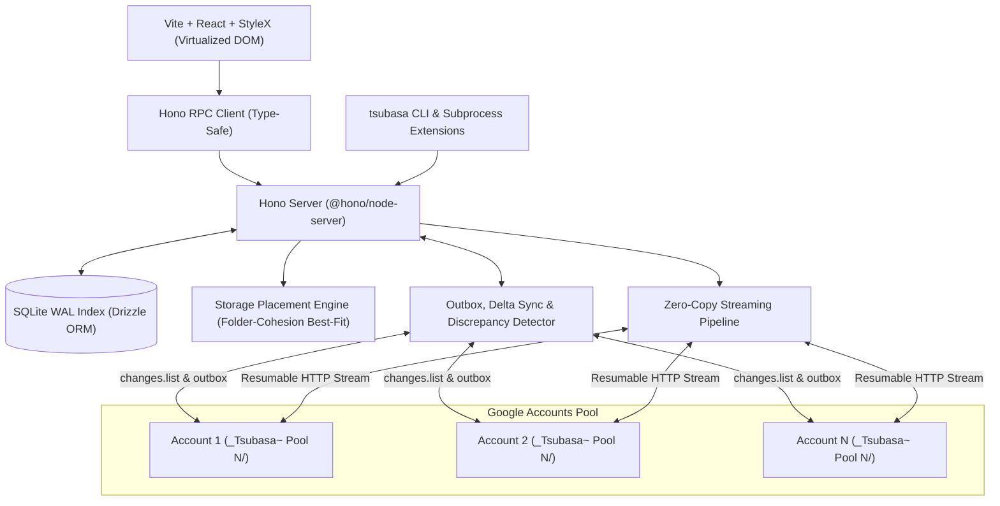
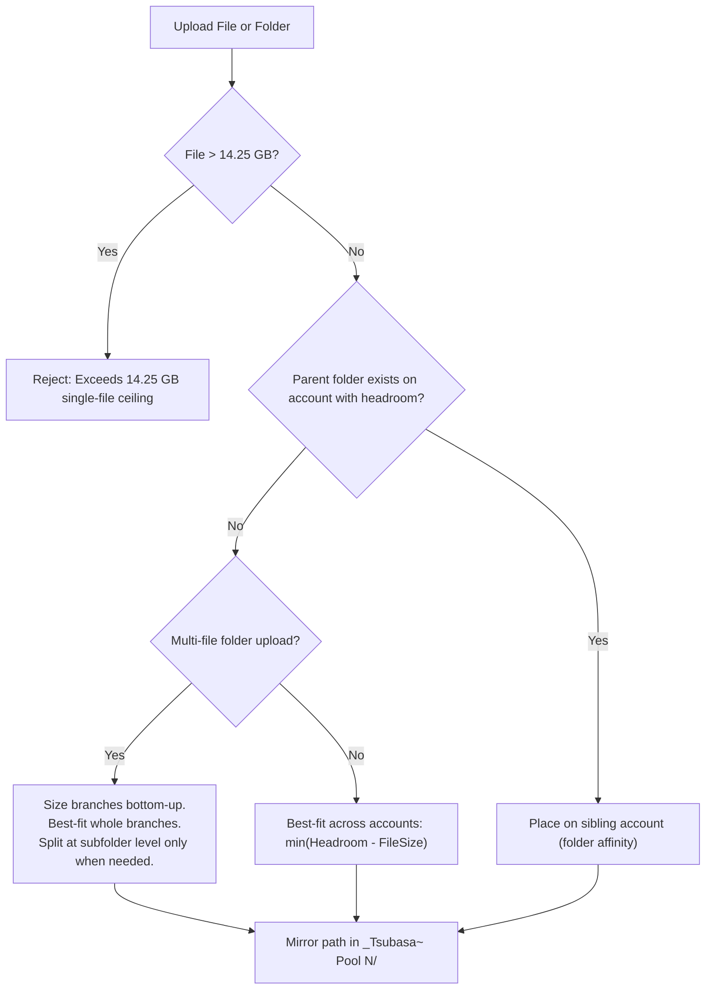
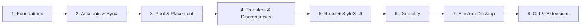

# Tsubasa~ Cloud technical roadmap

## 1. Architecture overview

Tsubasa pools personal Google Drive accounts into one virtual drive backed by a local SQLite WAL index (`data/tsubasa.db`). Files stay whole on single accounts without striping or splitting, and all navigation, search, and directory queries hit indexed local tables. One Desktop app OAuth client (`installed`) can authorize multiple accounts across pools using loopback redirects without pre-registered redirect URIs. See [README.md](../README.md#stack) for the full technology stack.



## 2. Performance directives

1. **Local-first reads.** Navigation, listings, and searches query indexed SQLite tables in under 2 ms without hitting Google Drive.
2. **Zero-copy streaming.** Uploads and downloads stream through Hono without buffering whole files in memory or local disk, staying under 50 MB RAM on 14 GB transfers.
3. **SQLite-first virtual writes.** Folder renames, moves, and soft-trashes commit locally right away. `drive_outbox` pushes Drive updates and `appProperties` asynchronously.
4. **Incremental delta sync.** After hydration, sync uses `drive.changes.list` with stored page tokens instead of full tree crawls.
5. **Constant-time DOM rendering.** TanStack Virtual keeps DOM node counts flat regardless of folder size.

## 3. Storage, transfers, and recovery

### 3.1 Pools, headroom, and safety reserve

- **Multi-pool and Share Pool.** Standard pools mirror under `_Tsubasa~ Pool <N>` per account. The Share Pool uses reserved ID `1_000_000` and `_Tsubasa~ Pool share`, rejects direct uploads, and records public batch folders in `share_links`.
- **Per-account ceiling.** 14.25 GB usable on a 15 GB account.
- **Safety reserve.** 750 MB reserved per account so Gmail, Google Photos, and account metadata do not hit quota limits.
- **Formula.** $\text{Headroom}_i = \max(0, \text{limit}_i - 750\text{ MB} - \text{usage}_i)$
- **System storage.** Snapshots, manifests, and mirrors under `/.tsubasa` are counted in account and pool metrics.

### 3.2 Folder-cohesion best-fit placement



1. **Single-file limit.** Any file over 14.25 GB fails validation immediately.
2. **Folder affinity.** If the parent directory already has files on an account with enough headroom and daily transfer quota, new files land on that account.
3. **Bottom-up branch sizing.** Folder uploads sum subtree sizes bottom-up, placing whole subfolders by best-fit and splitting at subfolder boundaries only when a branch exceeds single-account headroom.
4. **Physical mirroring.** Directories mirror inside each account's `_Tsubasa~ Pool <N>` folder, or `_Tsubasa~ Pool share` for the Share Pool.

### 3.3 Transfers and persisted jobs

- **Daily upload cap.** Google enforces a 750 GB rolling 24-hour upload limit per account, tracked in `transfer_logs` and shown per account in the sidebar and CLI.
- **Upload paths.** Files up to 5 MiB use a verified single-shot multipart path with MD5 check before SQLite commit (`POST /api/files/upload`). Larger files stream via a single-PUT resumable session in the UI (`POST /api/files/upload`) and via persisted chunked resumable sessions with MD5 verification before commit in the CLI (`POST /api/transfers/upload`, `PUT /api/transfers/:jobId/chunk`).
- **Downloads.** Downloads stream with HTTP `Range` support. The CLI adds `.part` resume and hash verification.
- **Persisted transfer jobs.** Long-running `upload`, `import_drive`, `cross_pool_move`, and `account_evacuate` jobs store state in `transfer_jobs`, `transfer_job_items`, and `transfer_job_shares` so interrupted transfers can resume or cancel cleanly.

### 3.4 Lifecycle and discrepancy handling

- **Soft delete and purge.** Deleting marks files trashed in SQLite and enqueues `trashed: true` in `drive_outbox`. Quota reclaims only on permanent purge (`DELETE /api/trash/empty` or single-file purge).
- **External changes.** The discrepancy scanner classifies five states: `overCeiling`, `conflicts`, `unindexed`, `modified`, and `missingRemote`. You can accept valid changes, resolve path conflicts, rebuild via cold sync, or rebalance over-ceiling accounts via cloud-to-cloud copy (`drive.files.copy`).
- **Over-ceiling files.** Files over 14.25 GB inside `_Tsubasa~ Pool <N>` are rejected by `acceptExternalFile`, cold sync, and delta sync (`FileExceedsCeilingError`). Resolve them with **Move to root** (`POST /api/sync/resolve/move-to-root`), which moves the file to `My Drive` root with zero extra bytes, clears its Tsubasa `appProperties`, and removes it from SQLite.

### 3.5 Cold recovery

Every managed file stores Drive `appProperties`:

```json
{
  "tsubasa_managed": "true",
  "tsubasa_virtual_path": "/Backups/archive.tar.gz",
  "tsubasa_virtual_id": "c4b9-...",
  "tsubasa_checksum": "<md5-hex>"
}
```

On a new machine, import Desktop OAuth JSON or `.env` credentials via the sidebar, `.oauths/`, or `tsubasa auth add`, then run a cold sync to rebuild `data/tsubasa.db` from Drive metadata.

## 4. Open roadmap (Phase 8+)

Phase 8 shipped the `tsubasa` CLI, canonical `tsubasa export` (`GET /api/export`), HTTP `Range` downloads, external Drive import, and the `extensions/<name>/manifest.json` subprocess runner (see [src/cli/README.md](../src/cli/README.md) and [extensions/README.md](../extensions/README.md)). The remaining items are still open:

- [ ] Add a thin client/server UI viewer hook so extensions can intercept file clicks in `src/client/`.
- [ ] Optionally add a web/UI entry field to `extensions/<name>/manifest.json` for serving extension bundles directly in the UI.
- [ ] Add `accounts.rootFolderId` to `standard` and `full` `tsubasa export` account records if extensions need account root Drive folder IDs.
- [ ] Sync Google Drive `modifiedTime` into `files.updatedAt` if downstream tools need upstream modification timestamps instead of local SQLite index time.

## 5. Completed milestones (Phases 1 to 7)



| Phase | Shipped scope |
|---|---|
| **1. Foundations** | TypeScript, Vite, StyleX (`unplugin-stylex`), Hono (`@hono/node-server`), and SQLite WAL (`better-sqlite3`, Drizzle ORM, runtime migrations in `src/server/db/init.ts`). Tables: `pools`, `accounts`, `folders`, `files`, `transfer_logs`, `share_links`, `pending_drive_sync`, `drive_outbox`, `transfer_jobs`, `transfer_job_items`, `transfer_job_shares`. |
| **2. Accounts & sync** | `.oauths/` scanner, OAuth client pool with token refresh, `drive.about.get(fields="user,storageQuota")` hydration, `_Tsubasa~ Pool <N>` and `_Tsubasa~ Pool share` root folders, cold-start recovery from `appProperties`, `drive.changes.list` delta sync, and Desktop app OAuth setup documented in `README.md` (Desktop app client type and production consent screen, linking to `temp/` for the full walkthrough). |
| **3. Pool & placement** | Dynamic 750 MB reserve headroom calculator, `/.tsubasa` system storage accounting, Folder-Cohesion Best-Fit placement with bottom-up branch sizing, Drive directory mirroring, and 24-hour rolling `transfer_logs` aggregation for the 750 GB daily cap. |
| **4. Transfers & discrepancies** | Streaming upload (`<= 5 MiB` verified single-shot multipart, `> 5 MiB` resumable streaming in UI and chunked persisted resumable in CLI) with 14.25 GB rejection, `Range`-capable download proxy, soft-trash/restore/purge (`DELETE /api/trash/empty`), discrepancy scanner (`overCeiling`, `conflicts`, `unindexed`, `modified`, `missingRemote`), Move to root for over-ceiling files, and cloud-to-cloud account rebalance. |
| **5. React + StyleX UI** | Design teardowns (`docs/teardowns/`) and reference tokens (`docs/reference-tokens/`) for Google Drive, MEGA, Dropbox, Hanekawa, and QuiviT Sage Mint. Responsive workspace shell, multi-pool sidebar, Share Pool workflow, pooled storage and headroom cards with masked emails, 24-hour transfer gauges, TanStack Virtual file table, upload queue drawer, external changes drawer, buffer-breach alerts, and Trash view. |
| **6. Durability & tuning** | Benchmarked local SQLite query latency at 100,000 file records, verified cold recovery after wiping `tsubasa.db`, and verified expired tokens, revoked access, quota limits, and virtualized scrolling frame rates. |
| **7. Electron desktop** | Electron main process hosting local Hono and the compiled Vite bundle, `app.requestSingleInstanceLock()`, backend `electron` vs `browser` instance lease priority (separate origins isolate `BroadcastChannel` and `navigator.locks`), tray icon and custom tray menu, `Start with Windows` with NSIS uninstall cleanup, close-to-tray, native title bar theme, inset rounded window rim (`BaseWindow` + `WebContentsView`), dynamic window title, and Windows NSIS installer plus portable `.zip` builds with `.portable` marker injection. |
