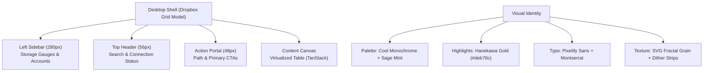

# Tsubasa~ Cloud styling and design guide

## 1. Design philosophy and visual direction

Tsubasa combines high-density desktop utility with deliberate visual texture. The design draws from four specific targets:

- **Dropbox desktop layout.** Structural separation through discrete grid tracks and portals. Clear borders and negative space define sections rather than blurred, floating cards.
- **MEGA mobile shell.** Minimalist mobile layout. 64px list rows, a clean top bar without visual bloat, and lightweight bottom sheet dialogs.
- **Hanekawa ~ cool monochrome and gold accents.** Base palette with cool, bluish-gray undertones, high-contrast monochrome values, and crisp gold (`#deb76c`) indicators for focus, selection, and drag highlights.
- **QuiviT sage-mint coherence.** Compact data density, high-contrast borders (`#9fb08a` light, `#2e4a41` dark), subtle hover tints, and precision scrollbars.

Google Drive styling is explicitly avoided. We do not use Google Drive's bulky row paddings, rounded pastel chips, or low-density search containers. Layout decisions prioritize rapid scanning, constant-time virtualized rendering, and strict WCAG AAA contrast.



---

## 2. Shell layout and spatial allocation

### Viewport size breakpoints vs pointer capabilities
Layout reflow and touch interaction are decoupled into two distinct query types:

- **Viewport width queries control layout:** Media queries based on width (such as `max-width: 768px`) dictate layout reflow, drawer collapse, and column visibility. Pointer type never decides layout. A desktop browser resized below 768px displays the compact single-column layout, and a high-resolution touchscreen tablet in landscape retains the full multi-column desktop shell.
- **Pointer queries control interaction physics:** `@media (pointer: coarse)` strictly dictates how touch and tap events behave, eliminating sticky hover bugs and enabling physical tap feedback.

### Desktop layout (Viewport >= 1024px)
The desktop interface uses a fixed, non-scrolling outer frame with isolated internal scroll containers.

- **Outer container:** `100vw` by `100vh`, `display: grid`, `overflow: hidden`.
- **Grid tracks:**
  - Column 1: `280px` fixed sidebar.
  - Column 2: `1fr` flexible workspace.
  - Row 1: `56px` global header.
  - Row 2: `48px` action and breadcrumb portal.
  - Row 3: `1fr` content canvas.
- **Left sidebar (`#tsubasa-sidebar`):**
  - Width: `280px`.
  - Border right: `1px solid var(--border)`.
  - Sections:
    1. Branding wordmark ("Tsubasa~ Cloud") at top.
    2. Navigation tree (All Files, Recent, Trash).
    3. Account cluster list with status badges.
    4. Bottom-anchored pool quota meter and 24-hour transfer gauges.
- **Top header (`#tsubasa-header`):**
  - Height: `56px`.
  - Border bottom: `1px solid var(--border)`.
  - Contains search input (max-width `520px`, height `36px`) and 3-way segmented theme selector (Auto, Light, Dark).
- **Action portal (`#tsubasa-actions`):**
  - Height: `48px`.
  - Border bottom: `1px solid var(--border-subtle)`.
  - Left: Interactive breadcrumbs with path affinity badges.
  - Right: Action pills ("Upload", "New folder", "Sync pool").
- **Content canvas (`#tsubasa-canvas`):**
  - Layout: `display: flex`, `flex-direction: column`, `flex: 1`, `overflow: hidden`.
  - Contains the virtualized TanStack table.

### Mobile layout (Viewport < 768px)
Mobile adapts MEGA mobile contracts to preserve vertical screen space.

- **Top header:** `56px` height. Hamburger drawer button on left, title in center, avatar/status on right.
- **List items:** `64px` height touch rows.
  - Column 1: `40px` leading icon or thumbnail.
  - Column 2: `1fr` file name and subtitle metadata.
  - Column 3: `40px` context menu trigger (three vertical dots).
- **Navigation drawer:** Off-canvas sliding panel (`300px` width) for account quotas and folder trees.
- **Bottom sheet:** Slides up from bottom for file actions, `16px` top border radius, `56px` touch target per row.

---

## 3. Color system and tokens

The color palette fuses Hanekawa's cool monochrome slate with QuiviT's sage-mint surfaces and gold highlights. All text pairings must meet WCAG AAA requirements (7:1 minimum contrast for body text, 4.5:1 for headings and bold indicators).

### Core palette tokens

| Role | Light mode | Dark mode | Contrast ratio | Notes |
| :--- | :--- | :--- | :--- | :--- |
| **Canvas background** | `#eef2ec` | `#0b1412` | - | Cool sage-gray base canvas. |
| **Surface container** | `#f7faf5` | `#12211d` | - | Primary card and table background. |
| **Surface elevated** | `#ffffff` | `#28443b` | - | Modals, context menus, and tooltips. |
| **Primary text** | `#111d18` | `#e5f2eb` | 14.8:1 (Light) / 13.9:1 (Dark) | Exceeds 7:1 AAA standard. |
| **Secondary text** | `#2d453b` | `#9bb8ab` | 8.2:1 (Light) / 7.2:1 (Dark) | Meets 7:1 AAA standard. |
| **Border stroke** | `#8ea194` | `#2d453b` | - | Crisp 1px structural separators. |
| **Border subtle** | `#c2d1c7` | `#1e302a` | - | Row dividers and nested outlines. |
| **Brand gold accent** | `#deb76c` | `#d4a13c` | 11.1:1 (with black text) | Selection borders, focus rings, badges. |
| **Selection background** | `#dcebe2` | `#1b3b32` | - | Highlighted table row background. |
| **Hover background** | `#e4ede7` | `#162d26` | - | Interactive row and button hover state. |
| **Success / status** | `#116329` | `#2dd4bf` | 7.8:1 (Light) / 7.85:1 (Dark) | Operational status and active badges. Dark tone sits on the cyan/teal side of green to prevent harsh neon cast. |
| **Danger red** | `#82071e` | `#ff9492` | 7.4:1 (Light) / 8.6:1 (Dark) | 750 MB buffer breach, errors, purge. |
| **Warning amber** | `#7a4400` | `#facc15` | 7.1:1 (Light) / 10.4:1 (Dark) | Sync pending, quota nearing limit. |

### Golden highlight usage rule
Gold (`#deb76c` / `#d4a13c`) must never be used as raw text on white or light surfaces, as its contrast ratio is only 1.88:1. Gold is applied strictly as:
1. Focused element outlines (`outline: 2px solid var(--accent-gold)`).
2. Active table row indicator bars (a 3px left border on selected rows).
3. Text selection background (`::selection { background: var(--accent-gold); color: #000000; }`).
4. Solid badge pills carrying dark text (`background: #deb76c; color: #111d18;`).

---

## 4. Typography contract

### Font family assignment
- **Branding and hero titles:** `Pixelify Sans` (`fonts/Pixelify_Sans/PixelifySans-VariableFont_wght.ttf`).
  - Used for the primary "Tsubasa~ Cloud" logo wordmark, version badges, and major empty-state headings.
- **Interface body, controls, and headers:** `Montserrat` (`fonts/Montserrat/Montserrat-VariableFont_wght.ttf`).
  - Clean geometric sans-serif used for table items, navigation labels, buttons, dialogs, and inputs.
- **Numeric metrics:** Tabular numbers applied to all data columns, file sizes, timestamps, and transfer readouts (`font-variant-numeric: tabular-nums`).

### Typographic scale

| Level | Font family | Size | Weight | Line height | Letter spacing | Usage |
| :--- | :--- | :--- | :--- | :--- | :--- | :--- |
| **Brand wordmark** | Pixelify Sans | `20px` | `600` | `1.2` | `0.02em` | Sidebar logo header. |
| **Page title** | Montserrat | `18px` | `600` | `1.3` | `-0.01em` | Current folder name in action bar. |
| **Section heading** | Montserrat | `13px` | `600` | `1.4` | `0.04em` | Sidebar category headers (uppercase). |
| **Body / Table row** | Montserrat | `13px` | `400` | `1.4` | `0` | File names, paths, menu options. |
| **Table header** | Montserrat | `11px` | `600` | `1.3` | `0.05em` | Column headers (Name, Size, Modified). |
| **Metadata / Subtitle** | Montserrat | `11px` | `400` | `1.3` | `0` | File size, date modified, account tag. |
| **Status badge** | Montserrat | `10px` | `600` | `1.2` | `0.02em` | Quota alerts, sync states, tags. |

---

## 5. Atmosphere and micro-styling

### Fractal noise grain overlay
An SVG fractal noise filter provides subtle paper-like texture across surfaces, softening flat digital planes without visual noise.

- **Source:** `src/client/global.css`
- **Filter configuration:**
  ```css
  :root {
    --surface-grain: url("data:image/svg+xml,%3Csvg viewBox='0 0 256 256' xmlns='http://www.w3.org/2000/svg'%3E%3Cfilter id='n'%3E%3CfeTurbulence type='fractalNoise' baseFrequency='0.9' numOctaves='4' stitchTiles='stitch'/%3E%3C/filter%3E%3Crect width='100%25' height='100%25' filter='url(%23n)' opacity='0.05'/%3E%3C/svg%3E");
    --surface-grain-size: 256px 256px;
  }
  ```
- **Application:** Applied via `.grain-overlay` (`position: fixed`, `inset: 0`, `pointer-events: none`, `z-index: 9999`, `opacity: 0.6`).

### Flat styling and elevation contract
Drop shadows, blurry box shadows, and card elevations are forbidden. All structural definition, active states, and panel separations are achieved through:
- Crisp 1px borders (`var(--border)` and `var(--border-subtle)`).
- Distinct surface values (`var(--surface)`, `var(--surface-alt)`, `var(--surface-container)`).
- Gold highlight left borders on selected rows (`3px solid var(--accent-gold)`).

### Section boundary dithering (Canvas dither strips)
To separate major layout sections without relying on drop-shadows or thick dividers, we use an abrupt ordered dither strip.

- **Mechanism:** A custom dynamic 2D canvas element (`4px` to `8px` height horizontally, or `4px` width vertically) mounted between sections.
- **Algorithm:** 4x4 Bayer threshold matrix quantizing transitions between the sidebar surface and workspace canvas.
- **Fallback:** When canvas rendering is disabled or unmounted, the divider defaults to `1px solid var(--border)`.

### Border radius scale
- **Square / Sharp (`0px`):** Table rows, sidebar primary navigation rows, canvas dividers, and viewport borders. Navigation rows span the full container width with flat vertical left-edge indicators to prevent curved crescent borders.
- **Compact (`4px`):** Context menu items, text inputs, status badges, and checkboxes.
- **Button pills (`8px` to `12px`):** Dropbox-inspired action buttons ("Upload", "New folder").
- **Avatars and circular indicators (`9999px`):** Account avatar icons and connection indicators.

### Precision scrollbar styling
Scrollbars follow the QuiviT specification to avoid taking up table width.

- **Width:** `6px` vertical, `6px` horizontal.
- **Track:** `transparent` or `var(--surface-container)`.
- **Thumb:** `var(--border)` with `3px` border radius.
- **Thumb hover:** `var(--secondary-text)`.

---

## 6. Core component specifications

### Virtualized file table (TanStack Virtual)
- **Container:** Viewport virtualization keeps DOM node counts constant regardless of whether a folder contains 10 or 50,000 files.
- **Row height:** Strictly fixed at `32px` (compact) or `38px` (comfortable).
- **Columns:**
  - Name and icon: `minmax(240px, 3fr)`
  - Owning account badge: `140px`
  - Size: `100px` (right-aligned, tabular nums)
  - Modified date: `140px` (right-aligned, tabular nums)
  - Quick action cluster: `80px` (hover-triggered)
- **Interactive row states:**
  - Idle: `background: transparent`.
  - Hover: `background: var(--hover-background)`.
  - Selected: `background: var(--selection-background)`, `border-left: 3px solid var(--accent-gold)`.
  - Focus-visible: `outline: 2px solid var(--accent-gold)`, `outline-offset: -2px`.

### Action buttons
Buttons use Dropbox-style pill geometry with high contrast.

- **Primary CTA ("Upload"):**
  - Height: `32px`, padding: `0 16px`, border radius: `8px`.
  - Light mode: background `#111d18`, text `#f7faf5`.
  - Dark mode: background `#e5f2eb`, text `#0b1412`.
  - Hover: 10% brightness shift.
- **Secondary CTA ("New folder", "Sync"):**
  - Height: `32px`, padding: `0 14px`, border radius: `8px`.
  - Background: `transparent`, border: `1px solid var(--border)`.
  - Text: `var(--primary-text)`.
  - Hover: `background: var(--hover-background)`.

### Storage quota gauges and account cluster
- **Pooled cluster meter:** Measures active Tsubasa files against total available pool headroom. External Google Drive items (Gmail, Photos) are isolated and do not count toward Tsubasa pool utilization.
- **Account cards:** Stacked list displaying account identity, remaining write headroom, overall Google Drive usage, and 24-hour upload ledger tally.
- **Email privacy masking:** Account emails use character-preserving 1:1 dot redactions (`arg•••••••••••ra@gmail.com`) rendered in monospace to guarantee zero layout shift on hover while retaining native text selection.
- **Buffer breach banner:** High-priority crimson alert (`#82071e` / `#ff9492`) triggered if an account enters over-ceiling mode (>14.25 GB).

---

## 7. Touch interaction and tap physics (@media (pointer: coarse))

Touch interactions follow strict rules to eliminate sticky hover artifacts and provide instant physical feedback.

### Global touch foundations
```css
@media (pointer: coarse) {
  body {
    -webkit-tap-highlight-color: transparent;
  }
}
```
- **Tap highlight removal:** `-webkit-tap-highlight-color: transparent` eliminates browser default tap rectangles.
### Sticky hover neutralization
Touchscreens fire `:hover` on tap, leaving elements highlighted after finger release. Inside `@media (pointer: coarse)`, all `:hover` visual overrides are reset:
- Button and wrapper hover: `background-color: unset`
- File row and card hover: `background-color: transparent` or base surface
- Image and avatar hover: `filter: unset`
- Link and date hover: `text-decoration: none`
- Action halo pseudo-elements: `opacity: 0`

### Tactile active tap contracts
All press feedback triggers on `:active` with an immediate `0.1s` (`100ms`) transition:

| Component | Idle state | Coarse hover state | Coarse active state | Transition |
| :--- | :--- | :--- | :--- | :--- |
| **Pill & action buttons** | Base surface | `background: unset` | `background: var(--rowHover)` or `#cfd0d1` | `background-color 0.1s ease` |
| **Table rows & list items** | Transparent | `background: transparent` | `background: var(--rowHover) !important` | `background-color 0.1s ease` |
| **Avatars & file previews** | `brightness(100%)` | `filter: unset` | `filter: brightness(85%)` | `filter 0.1s ease` |
| **Circular action buttons** | `opacity: 0` halo | `opacity: 0` halo | `opacity: 0.135` halo / tinted background | `background-color 0.1s ease` |
| **Links & clickable text** | `text-decoration: none` | `text-decoration: none` | `text-decoration: underline` | `text-decoration 0.1s ease` |

---

## 8. StyleX implementation architecture

All styling in Tsubasa must adhere to compile-time StyleX rules:

1. **No runtime CSS-in-JS or Tailwind.** Do not install or import Tailwind utility classes or runtime style generators.
2. **Tokens as source of truth.** Styles reference variables created via `stylex.defineVars`. Magic hex codes and arbitrary pixel margins are forbidden in component files.
3. **Flat style declarations.** Keep styles structured cleanly with `stylex.create`.
4. **Zero-cost theme switching.** Light and dark modes bind to `stylex.createTheme` using HTML data attributes (`data-theme="light"` or `data-theme="dark"`).
5. **Zero-pop-in theme hydration (LCP preservation).** User theme preferences are persisted in `localStorage` and synchronized via an inline blocking script in `<head>` prior to first paint. This eliminates theme flash and prevents cumulative layout shifts.
6. **Segmented control stability.** Active segmented options pin their background and text states on hover to avoid color flickering or inverse contrast shifts in dark mode.

