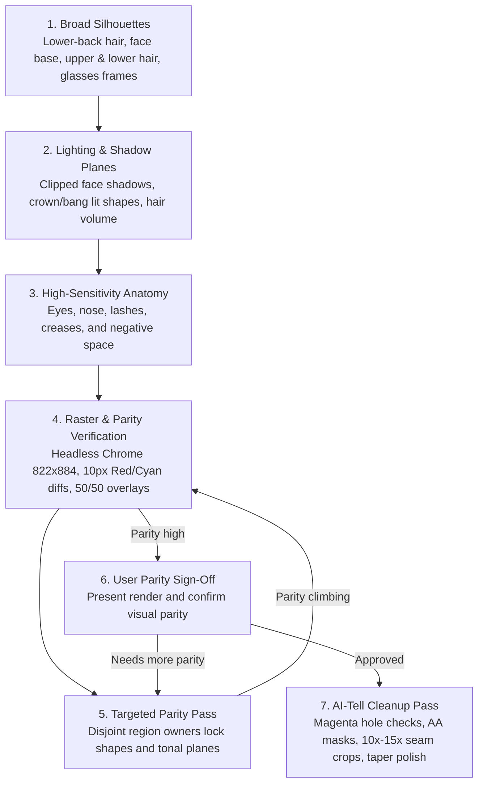

# Tsubasa~ Cloud SVG illustration and vector parity guide

## 1. Philosophy and intent

Brand vector art follows a hand-authored illustration model, not algorithmic tracing. The 8-color monochrome target ([brand-mono_8c.png](../src/client/assets/brand-mono_8c.png), `822x884`) carries rough manga sketch noise and dithered edges. The active portrait SVG ([svg-r44.svg](./svg-r44.svg), with shipped variants `svg-r44-app.svg`, `svg-r44-readme.svg`, and [src/client/assets/svg-r44.svg](../src/client/assets/svg-r44.svg)) targets visual parity with that monochrome look while stripping raster noise into clean vector curves.

Core rules:

1. **No algorithmic tracing or raster embeds.** Never run auto-tracers (`potrace`, bitmap vectorizers) or leave base64 `<image>` tags in shipped SVGs. Author every `<path>` with clean cubic Beziers and semantic IDs.
2. **Dual-reference balance.** Use [brand-mono_8c.png](../src/client/assets/brand-mono_8c.png) for monochrome value grouping and broad light/shadow planes. Use the original `brand.png` reference when requested for fine anatomy (eye gaze, iris proportions, lash attachment points, eyelid creases, negative-space pockets), translated strictly into the 8-color palette.
3. **Coarse-to-fine construction.** Lock broad silhouettes first, lay down lighting and shadow planes next, then spend path budget on facial geometry, tapered lashes, and catchlights.
4. **Human attention drives precision.** Generalized rules for stroke weight, shadow offset, and curve smoothing are starting points, not the full standard. Simplified cleanup is fine in outer hair, but a 2px misalignment, clipped highlight, cross-eyed gaze, or blunt cap on an eye or nose stands out immediately.
5. **Negative space equals dark ink.** Likeness relies on the cream (`#dfdfbd`) and grey (`#9ea09d`) pockets framed by lashes, bangs, glasses rims, and hair curtains. When porting fine linework from an earlier manual baseline (such as `svg-r1.svg`), adjust underlying sclera and shadow shapes instead of overlaying blindly.
6. **Strict 8-color palette.** Use only the 8 colors in `brand-mono_8c.png`. No off-palette hues, opacity hacks, or dead 0px shapes added to fill a checklist slot.

## 2. Exact 8-color monochrome palette

Every fill and stroke in the portrait SVG must come from this table, with no opacity hacks producing off-palette hues.

| Hex | Role and ownership | Common pitfalls |
|---|---|---|
| `#414546` | Primary charcoal ink: hair silhouettes, glasses wireframes, lower-back hair, eyelashes, brows, dark iris cores | Replacing midtone hair flow (`#515251`, `#636363`) makes hair masses look flat |
| `#9ea09d` | Cool mid-grey: lit crown/bangs/ahoge/back-right hair, inner cat ear, face/neck/sclera shadows, mouth, lower iris bowls | Bleeding across lit cheek/sclera pockets flattens depth; gaps against lashes create bright slivers |
| `#dfdfbd` | Warm cream: lit face/neck, peeking ear, crown speculars, hair clip lit plane, sclera bays, catchlights, iris reflection crescents | Swapping `#fdffe0` into eye catchlights or sclera creates a harsh stare |
| `#515251` | Dark-mid grey: secondary hair volume bands, eyelid creases, lower iris outer transitions | Blunt ends break flow; taper along the strand or contour |
| `#636363` | Medium-dark grey: recessed forehead-bang and neck cast shadows, transitions between `#9ea09d` and `#515251` in hair, ahoge, and cat-ear base, iris crescent mid-bevels | Omitting `#636363` causes harsh value jumps between `#9ea09d` and `#414546` |
| `#9c9c88` | Warm olive-grey: cast shadows, warm rim bevels on glasses, nose-bridge stroke, approved focal-eye accents | Heavy fringes around dark silhouettes or both eyes look like muddy fake AA halos |
| `#fdffe0` | Brightest cream highlight: strictly nose tip, cheek highlight inside left lens, small cheek specular glints | Overuse in eyes or hair washes out monochrome balance |
| `#3e3c3f` | Deepest charcoal in the quantized PNG: omit rather than adding a hidden 0px dot | Large pupil discs leave an off-tone spot inside `#414546` eyes; 1px dots add dead XML |

Audit tonal balance per region (eyes, nose, glasses, crown/bangs, cat ear, ahoge, back-right hair, face/neck) so global pixel counts do not hide local drift and every surface keeps its native light-to-dark hierarchy without raster-quantization confetti.

## 3. Layer architecture, naming, and invariants

### Anatomical left/right naming for eyes and glasses

All eye and glasses `id`s, `<clipPath>` `id`s, `clip-path="url(#...)"` references, and XML comments use Tsubasa's anatomical perspective, not screen sides:

- **Viewer's left (far-side 3/4 oblique):** `right` (`#eye-right`, `#brow-right`, `#right-iris-clip`, `#glasses-right`, `#temple-right`, `#lens-right`, `#lens-right-front-arc`, `#glasses-skin-shadow-right`).
- **Viewer's right (near-side focal):** `left` (`#eye-left`, `#brow-left`, `#eyelid-crease-left`, `#sclera-left`, `#iris-left`, `#lash-left-upper`, `#catchlight-left-main`, `#left-iris-clip`, `#glasses-left-and-bridge`, `#temple-left`, `#lens-left`, `#glasses-skin-shadow-left`).
- **Non-eye / non-glasses elements:** screen-side names (`#hair-lower-left`, `#shadow-neck-right`, `#hair-back-right-*`, `#hair-crown-left-*`).

### Circular crop and seven-layer z-order

Wrap the portrait in `<g id="portrait-root" clip-path="url(#portrait-circle-clip)">` matching the fitted bottom-right circular mask (`brand-mono_8c-circle.png`). Extend lower-back hair, face base, neck shadows, and upper hair 2 to 5px past the arc so the mask slices every lower-right edge cleanly.

Layer order solves overlapping depth without brittle boolean path subtraction. Keep the stack strictly bottom to top in seven main layers (with unmasked L4b `#peeking-ear-layer` tucked between `#face-layer` and `#eyes-layer`):

| Order | Group | Clipping | Ownership and role |
|---|---|---|---|
| 1 | `#hair-lower-back` | None | Dark lower-back strands behind neck; tuck top under `#face-base` and bottom past `#portrait-circle-clip` |
| 2 | `#glasses-right` | None | Far-side temple and full `#lens-right` ellipse behind `#hair-lower-left` so hair drapes over the lens |
| 3 | `#hair-lower-left` | None | Sole owner of lower-left hair curtain and volume planes; tuck base generously under `#face-base` |
| 4 | `#face-layer` | `#face-mask`, `#lens-left-upper-bevel-clip` on `#glasses-skin-shadow-left-upper` | Lit `#face-base`, broad face/neck/forehead-bang shadows, jaw contour, glasses skin shadows, cheek highlights, `#mouth` |
| 4b | `#peeking-ear-layer` | None (enclosed under L7 `#hair-upper-base`) | Unmasked sibling of `#face-layer` holding `#peeking-ear-base` and ear shadows so `#face-mask` never clips inside hair ear cutouts |
| 5 | `#eyes-layer` | `#right-iris-clip`, `#left-iris-clip`, `#iris-left-reflection-mask` | `#eye-right` and `#eye-left` (brows, creases, sclera, layered irises, catchlights, lashes) above `#face-layer` so dark ink masks underlying skin shadows |
| 6 | `#glasses-left-and-bridge` | `#lens-right-front-clip` on `#lens-right-front-arc` | Foreground `#414546` wireframe below upper hair: `#lens-right-front-arc`, `#nose-foreground`, `#glasses-bridge`, `#temple-left`, `#lens-left`, `#lens-left-glint` |
| 7 | `#hair-upper-layer` | `#upper-hair-clip` on `#hair-lit-planes` | Upper hair base, lit planes, `#cat-ear-inner`, and `#hair-clip` draped above foreground glasses |

### Layering and baseline rules

1. **Split glasses depth.** `#glasses-right` sits behind `#hair-lower-left` (Layer 2), foreground lenses/bridge sit above `#eyes-layer` (Layer 6), and `#hair-upper-layer` sits on top (Layer 7).
2. **True occlusion over path pinching.** Layer occluding forms (nose tip over right lens, bangs over left lens) cleanly above the rim instead of severing or pinching frame strokes.
3. **Exact math for paired strokes.** Derive clipped rim arcs and bevels from the underlying `<ellipse>` or cubic Bezier (de Casteljau splits + `<clipPath>`), never eyeballed parallel curves.
4. **Tag and preserve `USER-INTENTIONAL` baselines.** Tag approved manual paths and intentional stylistic overrides (manual brows, face contours, lower-left hair strands, verbatim lashes, cel-shaded hair clip, approved `#9c9c88` accents) with `USER-INTENTIONAL` XML comments, and treat tagged elements as read-only unless explicitly asked to change them.
5. **Single-owner boundaries and zero-drift relative paths.** Never duplicate hair inside an eye group or leave unclipped strokes outside `#face-mask`. When editing a mid-path relative segment on shared paths (such as `#shadow-forehead-and-sideburn`), keep `dx/dy` sums invariant so downstream coordinates shift `0.000px`.

## 4. Facial anatomy craft

- **Dual-eye gaze alignment.** Tune both eyes together against `brand.png` so pupil cores, dark upper iris weight, and lower bowls share one gaze direction.
- **Layered iris depth.** Size irises to their natural 3/4 oblique or focal proportions using nested layers: `#414546` base, `#515251` and `#636363` transition cradles, `#9ea09d` lower bowl, and `#dfdfbd` reflection crescents.
- **Continuous curves behind frames.** Run iris crescents and lower bowls continuously beneath Layer 6 rims instead of splitting them on either side of the wire.
- **Unclipped catchlights and organic sparkles.** Keep catchlights outside iris clips whenever they bridge an iris/lash edge so they do not slice flat. Draw sparkles as cubic Beziers, not `<circle>`/`<ellipse>` bullseyes.
- **Calligraphic lashes and creases.** Author creases, lower lashes, and lash flicks as filled `<path>` shapes that swell naturally through their body and taper to true 0px sharp points instead of uniform `stroke-linecap="round"` wireframe sticks. Verify lash attachment points (whether a lash sprouts from the lid line or emerges from behind a glasses frame) and clearance from neighboring hair against `brand.png`.
- **Contoured sclera and hidden shadow joins.** Tuck sclera bays and `#9ea09d` lid shadows behind dark lashes and iris rims. Where two `#9ea09d` shadow paths meet behind a fine lash spike, snap them to a shared vertex hidden inside dark ink so no blocky corner peeks out at high zoom.
- **Plane-based nose and mouth.** Never outline the nose in `#414546`. Build `#nose-foreground` from `#dfdfbd` skin occlusion, `#9c9c88` bridge stroke, and `#fdffe0` highlight planes above `#lens-right-front-arc`, paired with `#shadow-forehead-and-sideburn` underneath. Keep `#mouth` organically asymmetrical and `#cheek-highlight` smooth cubic Beziers (no `L` staircases).

## 5. Hair and volume planes

- **Inset dark outer rim.** Keep upper hair base solid `#414546` and inset lit crown planes inside `#upper-hair-clip` so the base peeks through as a crisp contour without extra outline strokes.
- **Tapered bands and consistent bang light.** Taper `#515251` and `#636363` bands to pointed organic ends rather than flat-chopped planks. Pair bang highlights on upper lit ridges with `#515251` shade underlays.
- **Edge-riding ahoge planes.** Layer ahoge shade, midtone, and lit bands as slim edge-riding planes converging to one top tip and tapering into a cushioned V-root at the crown rather than bulbous concentric loops.
- **Clean cutouts and cel accessories.** Pair back-right lit planes with broader `#515251` underlays flowing into `#portrait-circle-clip`. Keep peeking skin cutouts and `#hair-clip` in flat cel planes with zero background hair collisions.

## 6. Eliminating AI tells

High pixel-parity scores do not guarantee human-looking vector art. Chasing raw pixel counts creates machine tells (floating seams, fake AA fringes, eye confetti, geometric primitives), and mixing cleanup into parity climbing produces timid, over-smoothed shapes that stall progress. Lock shapes and tonal planes first, get user sign-off on visual parity, then run a dedicated cleanup pass enforcing these nine rules:

1. **Overlap blocking over edge-to-edge seams.** Tuck lower fills generously under upper fills instead of tracing shared curves edge-to-edge.
2. **Zero transparent interior seams.** Composite renders over `#ff00ff` magenta and confirm `0 px` unintended interior holes via connected-component check.
3. **No double-edge AA hairlines.** Clipping an overlay to the same contour as a contrasting unclipped base fill anti-aliases both edges separately and leaks a lighter hairline along the rim. Wrap the base (with a matching-color bleed stroke) and its overlays inside one shared `<mask>` so the outer edge anti-aliases once.
4. **Shared geometric clip masks.** Use `#portrait-circle-clip` for circular edges and extend clipped fills 2 to 5px past the mask.
5. **No abrupt cutoffs.** Tuck open ends into overlapping masses or taper to 0px inside a shadow transition.
6. **Coherent anatomy over shard stacking.** No disconnected polygon shards or axis-aligned rectangles added to inflate pixel scores.
7. **No unrequested fake AA halos or dead tokens.** No 1 to 3px quantization fringes and no 0px palette placeholders; use `#9c9c88` accents only where approved.
8. **Organic Beziers over primitives.** Replace `L` staircases, uniform round-capped tubes, ruler-straight shadows, bullseye `<circle>`/`<ellipse>` catchlights, and blunt tips with tapered cubic Beziers.
9. **Strict occlusion order.** Maintain hair/glasses/face/eye depth so bangs drape over frames and glints never sit over unrelated dark ink.

## 7. Iterative verification loop

Keep temporary renders and scripts in scratch so `docs/` stays clean:

1. **Confirm target scope.** When feedback could apply to two adjacent features, confirm the exact element ID or region first.
2. **Deterministic rasterization.** Render at exact `822x884` via headless Chrome (`--headless=new --disable-gpu --window-size=822,884 --default-background-color=00000000 --screenshot=<out.png>`) or Inkscape.
3. **Magenta gap check.** Composite over `#ff00ff` and verify `0 px` unintended interior holes (excluding open lens areas outside the silhouette).
4. **Circle-arc alignment.** Measure the bottom-right opaque boundary against `brand-mono_8c-circle.png` when touching outer silhouettes (`< 1.0px` RMSE, zero notches).
5. **Red/Cyan parity diffs against `brand-mono_8c.png`.** Run 10px gridded diffs at 1x, 2x, and 4x/6x crops:
   - **Red** = SVG is *too dark* (target is lighter). Move light planes toward Red or trim dark ink.
   - **Cyan** = SVG is *too light* (target is darker). Move light planes away from Cyan or extend dark ink.
   - Always verify polarity before editing so highlights never shift backwards.
6. **50/50 overlays on `brand.png`.** Blend `brand.png` and rendered SVG at 6x to 10x zoom for fine anatomy (lashes, creases, sockets, iris bowls).
7. **High-magnification `viewBox` checks.** Render cropped `viewBox` views at 12x to 15x native vector resolution for tight multi-path junctions (lash needle tips, bevel tapers, shadow corners) to catch blocky sub-pixel overlaps invisible at `822x884`.
8. **Paired 1x and dual-eye gaze checks.** Always pair zoomed edits with a 100% side-by-side vs `brand.png` and a dual-eye strip (`200..515 x 485..695`). Details that look tidy at 10x can disappear at 1x or skew gaze alignment across the face.
9. **ROI pixel-diff and XML hygiene.** Confirm `0 px` unintended drift outside the edited bounding box. On pure refactors or ID renames, verify `max_delta=0`, valid XML, `0` duplicate IDs, `0` broken `url(#...)`, `0` disallowed hex colors, and `0` `<image>` tags.

## 8. Agent, model, and swarm allocation

Check live quotas (`swarm{action:"models"}`) before scaling a swarm, and switch waiting workers in place (`swarm{action:"model"}`) when a pool runs low instead of killing coordinate context.

| Role | Tier | Responsibilities |
|---|---|---|
| **Lead visual auditors** | High (Neon High or Argon High) | Disjoint region diagnosis (`eyes`, `structure`, `hair`), scratch prototypes (`v*_test.svg` + 6x to 15x overlays), anatomical fixes, visual sign-off |
| **Coordinator and sole SVG writer** | Medium (Neon Medium, Argon Medium, or Hydrogen High) | Coordinator routes work and user review; one sole writer (`svg-crafter`) merges verified `<path>` specs into the live SVG |
| **Independent verifier and scaffolding** | Low (Neon Low or Argon Low) | Headless Chrome renders, `#ff00ff` gap checks, ROI diffs, 10px diff quads, 1x/10x/15x strips, XML/palette hygiene, doc formatting |
| **Atomic renamer (on demand)** | Medium | Two-pass temp-token ID/comment renames across portrait SVGs and docs, gated on `max_delta=0` and `0` broken `url(#...)` |
| **Hydrogen Medium** | Dropped | Excluded from all stages |

Swarm rules:

1. **Pre-pack briefs.** Include the active SVG path, exact Chrome command, target reference (`brand-mono_8c.png` vs `brand.png`), and any annotated user screenshots.
2. **Read-only disjoint auditors.** Run auditors in parallel only on non-overlapping regions/layers and route all live SVG writes through the sole writer.
3. **Batch scratch checks.** Run render, 50/50 overlay, ROI diff, and magenta gap check in one Python script per candidate instead of burning turns per tweak.
4. **Declare shared-boundary invariants.** Report exact `dx/dy` zero-drift verification when touching `#shadow-forehead-and-sideburn`, `#face-mask`, or `#upper-hair-clip`.
5. **Skip swarms for trivial edits.** Route single-path reverts or simple coordinate swaps directly to the sole writer and verify `0` unintended pixel drift.
