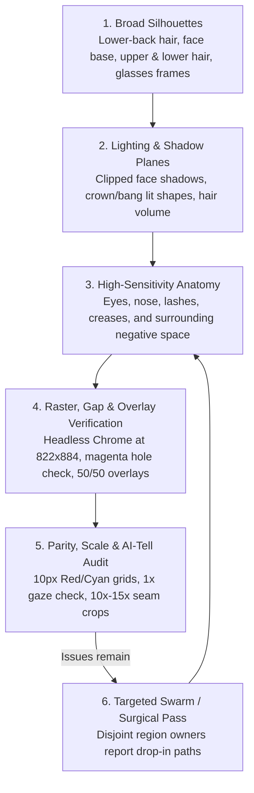

# Tsubasa~ Cloud SVG illustration and vector parity guide

## 1. Philosophy and intent

Vectorizing brand artwork for Tsubasa~ Cloud follows a hand-authored illustration model rather than algorithmic conversion. The 8-color monochrome target ([brand-mono_8c.png](./brand-mono_8c.png), `822x884`) carries rough manga sketch noise, dithered brush edges, and pixelated anti-aliasing. The goal in the active portrait SVG (currently [svg-v35.svg](./svg-v35.svg)) is strong visual parity with that stylized monochrome target while stripping away raster noise so every edge reads as clean, deliberate vector art.

Six core rules govern every pass:

1. **No algorithmic tracing or raster embeds.** Do not run auto-tracers (`potrace`, bitmap vectorizers) and do not leave hidden base64 `<image>` layers inside shipped SVGs. Author every `<path>` with clean cubic Beziers and semantic IDs.
2. **Dual-reference balance.** Use [brand-mono_8c.png](./brand-mono_8c.png) as the primary reference for stylized monochrome parity, cel-shaded value grouping, and broad light-and-shadow planes. Use [brand.png](./brand.png) as the anatomical reference whenever the user asks for finer detail accuracy (eye gaze alignment, iris proportions, lash shapes and attachment points, eyelid crease tapers, or subtle negative-space pockets), translating those details strictly into the 8-color monochrome palette.
3. **Coarse-to-fine construction.** Build broad silhouettes first, lay down large lighting and shadow planes next, and only then spend path budget on fine facial geometry, tapered lashes, catchlights, and micro-glints.
4. **Human attention drives precision.** Generalized rules for stroke weight, shadow offset, and curve smoothing are starting points, not the full standard. Viewers forgive simplified cleanup in outer hair, but immediately catch a 2px misalignment, clipped highlight, cross-eyed gaze, or blunt cap on an eye or nose.
5. **Negative space carries equal weight to dark ink.** Facial likeness depends just as much on the cream (`#dfdfbd`) and grey (`#9ea09d`) pockets framed by lashes, bangs, glasses rims, and hair curtains. When porting finer linework from a manual baseline (such as [svg-v1.svg](./svg-v1.svg)), audit and adjust the underlying sclera and shadow shapes instead of overlaying the path blindly.
6. **Strict palette with artistic intent.** Use only the 8 colors in `brand-mono_8c.png`. Never add off-palette hues or opacity hacks, and never insert invisible or dead shapes solely to check off a palette slot.

---

## 2. Exact 8-color monochrome palette contract

`brand-mono_8c.png` uses an 8-color palette. Every fill and stroke in the portrait SVG must come from this table, with no opacity hacks creating off-palette hues.

| Hex | Role and surface ownership | Common pitfalls |
| :--- | :--- | :--- |
| `#414546` | Primary charcoal ink. Hair silhouettes, glasses wireframes, lower-back hair strands, eyelashes, eyebrows, and dark iris cores. | Letting flat `#414546` replace midtone hair flow (`#515251`, `#636363`) makes large hair masses look heavy and flat. |
| `#9ea09d` | Cool mid-grey. Lit hair crown, bangs, ahoge outer sweep, back-right hair planes, inner cat ear, forehead/cheek/neck/sclera shadows, mouth, and luminous lower iris bowls. | Letting `#9ea09d` shadows bleed across lit cheek or sclera pockets flattens facial depth; leaving abrupt gaps between shadows and thin lashes creates jagged bright slivers. |
| `#dfdfbd` | Warm cream. Lit face and neck base, peeking human ear, hair crown speculars, hair clip lit plane, lit sclera bays, eye catchlights, and tapered lower iris reflection crescents. | Swapping `#dfdfbd` for `#fdffe0` inside eye catchlights or sclera creates a harsh stare. |
| `#515251` | Dark-mid grey. Secondary hair volume bands, eyelid creases, and lower iris outer depth transitions. | Drawing `#515251` bands with blunt ends breaks flow; taper transition bands along the strand or contour. |
| `#636363` | Medium-dark grey. Soft transitions between `#9ea09d` and `#515251` in hair and cat-ear bases, tapered nose-bridge contour, and iris crescent mid-bevels. | Omitting `#636363` leaves harsh value jumps between `#9ea09d` and `#414546`. |
| `#9c9c88` | Warm olive-grey. Cast shadows and stylized warm rim bevels along glasses frames, warm nose-bridge shading, and selective warm accents inside the focal eye where approved. | Applying heavy unrestrained `#9c9c88` fringes around dark silhouettes or on both eyes without user approval creates muddy fake anti-aliasing halos. |
| `#fdffe0` | Brightest cream highlight. Reserved strictly for the nose tip highlight, cheek highlight inside the left lens, and small cheek specular glints. | Overusing `#fdffe0` in eyes or hair washes out the muted monochrome balance. |
| `#3e3c3f` | Deepest charcoal accent in the quantized PNG. Omit from the SVG rather than placing a hidden 0px dot just to fill a checklist slot. | Using `#3e3c3f` as a large pupil disc leaves a noticeable off-tone spot inside `#414546` eyes, while a 1px token adds dead XML with no visual value. |

### Per-surface tonal discipline

Global pixel counts miss local tonal drift. Audit value balance per surface (both eyes, nose, glasses, crown and bangs, cat ear, ahoge, back-right hair, face and neck) so every region keeps its native light-to-dark hierarchy without resorting to raster-quantization confetti.

---

## 3. Layer architecture, naming, and invariants

### Anatomical left/right naming standard for glasses and eyes

All glasses and eye identifiers (element `id`s, `<clipPath>` `id`s, `clip-path="url(#...)"` references, and XML comments) use Tsubasa's anatomical perspective, not the viewer's left and right:

- **Viewer's left (far-side 3/4 oblique eye and lens)** uses `right` (`#eye-right`, `#brow-right`, `#right-iris-clip`, `#glasses-right`, `#temple-right`, `#lens-right`, `#lens-right-front-arc`, `#glasses-skin-shadow-right`).
- **Viewer's right (near-side focal eye and lens)** uses `left` (`#eye-left`, `#brow-left`, `#eyelid-crease-left`, `#sclera-left`, `#iris-left`, `#lash-left-upper`, `#catchlight-left-main`, `#left-iris-clip`, `#glasses-left-and-bridge`, `#temple-left`, `#lens-left`, `#glasses-skin-shadow-left`).
- **Non-eye and non-glasses elements** keep their screen-side names (`#hair-lower-left`, `#shadow-neck-right`, `#hair-back-right-*`, `#hair-crown-left-*`).

### Global circular crop and seven-layer z-order

Wrap the portrait inside `<g id="portrait-root" clip-path="url(#portrait-circle-clip)">` using the fitted bottom-right circular mask matching [brand-mono_8c-circle.png](./brand-mono_8c-circle.png). Extend lower-back hair, face base, neck shadows, and upper hair past the arc so the mask slices every lower-right boundary flush without hand-ending individual curves.

Layer order solves overlapping depth without brittle boolean path subtraction. Keep the stack strictly bottom to top in seven groups:

| Order | Group | Clipping rule | Ownership and layering role |
| :---: | :--- | :--- | :--- |
| 1 | `#hair-lower-back` | None | Dark lower-back hair strands behind the neck. Tuck top edges under `#face-base` and bottom edges past `#portrait-circle-clip`. |
| 2 | `#glasses-right` | None | Far-side temple and full `#lens-right` ellipse behind `#hair-lower-left` so the lower-left hair curtain drapes over the middle of the lens. |
| 3 | `#hair-lower-left` | None | Single owner of the lower-left hair curtain and its secondary volume planes. Tuck its base silhouette generously under `#face-base`. |
| 4 | `#face-layer` | `#face-clip` on `#face-shading` | Lit `#face-base`, broad face/neck/ear shadows, clipped tapered jaw contour, nose bridge shadow, glasses skin cast shadows, cheek highlights, and `#mouth`. |
| 5 | `#eyes-layer` | `#right-iris-clip`, `#left-iris-clip` | `#eye-right` (far-side oblique eye) and `#eye-left` (near-side focal eye), including brows, creases, sclera, layered irises, catchlights, and lashes. Layered above `#face-layer` so dark ink masks underlying skin shadows. |
| 6 | `#glasses-left-and-bridge` | Targeted clip paths on rim arcs and bevels | Foreground `#414546` wireframe layered below upper hair: clipped front arc of `#lens-right`, foreground nose occlusion (`#nose-foreground` where the nose bridge overlaps the right lens), `#glasses-bridge`, `#temple-left`, `#lens-left`, and stylized rim glints. |
| 7 | `#hair-upper-layer` | `#upper-hair-clip` on `#hair-lit-planes` | Layered above foreground glasses so bangs and side locks naturally drape over frames and temples. Holds upper hair base, lit planes, `#cat-ear-inner`, and `#hair-clip`. |

### Layering and baseline protection rules

1. **Split glasses depth.** Keep `#glasses-right` behind `#hair-lower-left` (Layer 2), foreground lenses and bridge above `#eyes-layer` (Layer 6), and `#hair-upper-layer` on top (Layer 7) so hair overlaps frames naturally.
2. **True 3D occlusion over fake path pinching.** When a foreground form overlaps a glasses rim (such as the nose tip over the right lens or bangs over the left lens), layer the occluding shape cleanly above the rim rather than hand-pinching or severing the frame stroke.
3. **Reuse exact mathematical geometry for paired strokes.** Derive clipped foreground rim arcs and glasses bevels from the exact underlying `<ellipse>` or cubic Bezier (via de Casteljau splits and `<clipPath>` masks) rather than eyeballing parallel hand curves that drift lopsided.
4. **Preserve `USER-INTENTIONAL` baselines.** Tag approved manual paths and intentional stylistic overrides (such as manual brows, face contours, lower-left hair strands, verbatim lashes, cel-shaded hair clip shapes, and approved `#9c9c88` accents) with `USER-INTENTIONAL` XML comments. Treat tagged elements as read-only unless the user explicitly requests changes to them.
5. **Single-owner boundaries and zero-drift relative paths.** Never duplicate a hair layer inside an eye group to patch a gap, and never leave unclipped strokes outside `#face-clip`. When editing a mid-path relative segment on a long shared path (such as `#shadow-forehead-and-sideburn`), keep the segment `dx/dy` sum invariant so downstream coordinates shift by `0.000px`.

---

## 4. High-sensitivity facial anatomy craft

Faces have zero tolerance for mechanical SVG artifacts. Apply these generalized principles across both eyes, the nose, and the mouth:

- **Gaze alignment across both eyes.** Never tune one eye in isolation. Check both eyes together against `brand.png` so pupil cores, dark upper iris weight, and lower luminous bowls lock onto the same gaze direction with zero cross-eyed drift.
- **Full-height anatomical proportion and layered iris depth.** Size each iris to match its natural 3/4 oblique or focal proportions and build interior lighting from coherent nested layers: dark `#414546` base, `#515251` and `#636363` transition cradles, a luminous `#9ea09d` lower bowl, and curved `#dfdfbd` reflection crescents.
- **Continuous curves behind occluding frames.** Run iris reflection crescents and lower bowls continuously underneath Layer 6 glasses rims rather than splitting them into disjoint fragments on each side of the wire.
- **Unclipped focal catchlights and organic sparkles.** Place primary catchlights outside iris clip paths whenever they bridge an iris/lash boundary so they do not slice into flat D-shapes. Draw interior sparkles as organic cubic Beziers rather than concentric geometric `<circle>` or `<ellipse>` bullseyes.
- **Filled calligraphic lashes and eyelid creases.** Author eyelid creases, lower lashes, and fine lash flicks as filled `<path>` shapes that swell naturally through their body and taper to true 0px sharp points rather than uniform `stroke-linecap="round"` wireframe sticks. Verify lash attachment points (whether a lash sprouts from the lid line or emerges from behind a glasses frame) and clearance from neighboring hair directly against `brand.png`.
- **Contoured sclera and seamless shadow joins.** Shape sclera bays and upper-lid `#9ea09d` shadows with smooth organic curves tucked cleanly behind dark lashes and iris rims. Where two `#9ea09d` shadow paths meet behind a fine lash spike, snap them to a shared hidden vertex inside the dark ink so no blocky corner peeks out at high zoom.
- **Plane-based nose and asymmetrical mouth.** Never outline an anime nose in `#414546`. Construct it from shadow, warm bridge transition, tapered `#636363` contour, and `#fdffe0` highlight planes. Keep `#mouth` organically asymmetrical and author `#cheek-highlight` with smooth cubic Beziers rather than straight `L` staircases.

---

## 5. Hair, silhouette, and secondary volume planes

Translating rough manga hair into clean cel vector art relies on layered, tapered planes rather than hatching or boxy blocks:

- **Natural dark outer rim via inset.** Keep the upper hair base solid `#414546` and inset lit crown planes inside `#upper-hair-clip` so the dark base peeks through as a crisp contour without adding separate outline strokes.
- **Tapered volume bands and consistent lighting.** Taper every `#515251` and `#636363` transition band to pointed organic ends rather than flat-chopped planks. Place bang highlights on upper lit ridges paired with `#515251` shade underlays so forehead lighting stays consistent.
- **Edge-riding ahoge planes.** Layer ahoge shade, midtone, and lit bands as slim edge-riding planes converging to one crisp top tip and tapering cleanly into a cushioned V-root at the crown rather than bulbous concentric loops.
- **Clean cutouts and cel-shaded accessories.** Pair back-right lit planes with slightly broader `#515251` underlays flowing into `#portrait-circle-clip`. Keep peeking skin cutouts and accessories (such as `#hair-clip`) in flat, crisp cel planes with zero unintended background hair collisions behind them.

---

## 6. Eliminating AI tells in hand-authored SVG

High pixel-parity scores do not guarantee human-looking vector art. Chasing raw pixel counts often creates machine tells: floating seams, fake anti-aliasing fringes, eye confetti, and geometric primitives. Enforce these eight rules on every pass:

1. **Overlap blocking over edge-to-edge seam chasing.** Tuck lower layers generously underneath upper layers instead of tracing two fills edge-to-edge along a shared curve and hoping anti-aliasing hides the seam.
2. **Zero transparent interior seams.** White or checkerboard previews hide 1px holes. Composite every render over flat `#ff00ff` magenta and run a connected-component check to confirm `0 px` unintended interior holes.
3. **Exact geometric clip masks for hard boundaries.** Use one shared `<clipPath>` (`#portrait-circle-clip`) for circular portrait edges and extend clipped layers 2 to 5px past the mask.
4. **No abrupt cutoffs or dangling ends.** Tuck open ends cleanly into overlapping masses or taper them to 0px inside a shadow transition.
5. **Artistic intent over parity-quota stacking.** Build focal areas from coherent anatomical layers rather than disconnected polygon shards or axis-aligned rectangles added to bump pixel counts.
6. **No unrequested fake AA halos or dead quota tokens.** Never add 1 to 3px fringe strokes just to mimic raster quantization edges, and never insert invisible 0px elements to fill a palette slot. Use stylized `#9c9c88` accents only where intentionally designed and approved.
7. **Organic Bezier craft over mechanical primitives.** Replace straight `L` staircases, uniform round-capped detail tubes, ruler-straight shadow lines, geometric bullseye `<circle>`/`<ellipse>` catchlights, and blunt sausage tips with smooth, tapered cubic Beziers.
8. **Natural foreground and background occlusion.** Maintain strict depth order across hair, glasses, face, and eyes so bangs drape over frames and light glints never sit awkwardly on top of unrelated dark ink.

---

## 7. Iterative verification loop

Visual intuition misses 1 to 3px drift, sub-pixel seam notches, and scale-dependent balance shifts. Every refinement cycle runs a closed verification loop, keeping temporary renders and scripts in the scratch directory so `docs/` stays clean:

1. **Confirm target scope before editing.** When user feedback arrives without an annotated screenshot or could apply to two adjacent features, confirm the exact element ID or region before authoring edits so passes do not drift onto a neighboring path.
2. **Deterministic rasterization.** Render the active SVG to PNG at exact `822x884` dimensions using headless Chrome (`--headless=new --disable-gpu --window-size=822,884 --default-background-color=00000000 --screenshot=<out.png>`) or Inkscape.
3. **Magenta-backdrop gap check.** Composite the PNG over `#ff00ff` and run connected-component analysis to verify `0 px` unintended interior holes (counting only intentional open lens areas outside the face/hair silhouette).
4. **Circle-arc alignment check.** Measure the bottom-right opaque boundary against `brand-mono_8c-circle.png` when touching outer silhouettes and confirm sub-pixel RMSE (`< 1.0px`) with zero notches.
5. **Directional Red/Cyan parity diffs against `brand-mono_8c.png`.** Use 10px gridded diffs at 1x full canvas, 2x face surroundings, and 4x/6x feature crops for broad monochrome parity:
   - **Red pixels** mean the SVG is *too dark* (target is lighter). Move light planes toward Red or trim dark ink back.
   - **Cyan pixels** mean the SVG is *too light* (target is darker). Move light planes away from Cyan or extend dark ink into Cyan.
   - Always verify polarity before editing so highlights never shift backwards.
6. **50/50 alpha overlays on `brand.png` for fine anatomy.** When matching anatomical details from `brand.png` (lashes, spurs, eyelid creases, eye sockets, iris bowls), composite a 50/50 alpha blend of `brand.png` and the rendered SVG at 6x to 10x zoom to catch 1px angle, thickness, and height errors on the first try.
7. **Native high-magnification `viewBox` checks.** For tight multi-path junctions (lash needle tips, bevel tapers, shadow corners), render a cropped `viewBox` at 12x to 15x native vector resolution to catch blocky sub-pixel overlaps invisible at `822x884`.
8. **Paired 100% (1x) and dual-eye gaze checks.** Always pair high-zoom edits with a 100% side-by-side comparison against `brand.png` and a dual-eye strip (`200..515 x 485..695`). Details that look tidy at 10x can disappear at 1x or skew gaze alignment across the face.
9. **ROI pixel-diff and hygiene checks.** On localized edits, compute changed pixels against the prior render to confirm `0 px` unintended drift outside the target bounding box. On pure refactors or ID renames, verify `0` changed pixels (`max_delta=0`), valid XML, `0` duplicate IDs, `0` broken `url(#...)` references, `0` disallowed hex colors, and `0` embedded `<image>` tags.

---

## 8. Agent, model, and swarm allocation

Assign roles by failure mode and live quota headroom rather than habit. Check live quotas (`swarm{action:"models"}`) before dispatching or scaling a swarm, and switch waiting workers in place (`swarm{action:"model"}`) when a pool runs low instead of killing accumulated coordinate context.

### Role and tier allocation

| Role | Recommended tier | Assigned responsibilities |
| :--- | :--- | :--- |
| **Lead visual auditors** | High tier (Neon High or Argon High, by live quota) | Disjoint region-scoped diagnosis (`eyes`, `structure`, `hair`), scratch prototyping (`v*_test.svg` + 6x to 15x 50/50 overlays), hard anatomical troubleshooting, and independent visual sign-off. |
| **Coordinator and sole SVG writer** | Medium tier (Neon Medium or Argon Medium, by live quota; Hydrogen High when primary pool is healthy) | Coordinator manages task routing and user review; one designated sole writer (`svg-crafter`) merges verified `<path>` drop-in specs into the live SVG so concurrent workers never collide on edits. |
| **Independent verifier and scaffolding** | Low tier (Neon Low or Argon Low, by live quota) | Headless Chrome rasterization, `#ff00ff` magenta hole checks, ROI pixel-diff checks, 10px gridded diff quads, 1x/10x/15x comparison strips, XML/palette hygiene checks, and doc formatting passes. |
| **Atomic renamer (on demand)** | Medium tier | Dedicated two-pass temp-token ID and comment renames across all portrait SVGs and docs, gated on `0` changed pixels (`max_delta=0`) and `0` broken `url(#...)` references. |
| **Hydrogen Medium** | Dropped | Excluded from all stages. Neon Medium and Hydrogen High cover its range better. |

### Swarm execution rules

1. **Pre-pack exact paths, commands, and references in briefs.** Include the active SVG path, exact headless Chrome command, target reference image (`brand-mono_8c.png` vs `brand.png`), and any annotated user screenshots so workers start on geometry on turn 1.
2. **Keep auditors read-only on disjoint regions.** Run auditors in parallel only on non-overlapping regions or layers (for example, Layer 4 rim bevels vs Layer 5 right eye) and route every live file write through the sole SVG writer.
3. **Batch candidate checks in scratch.** Test candidate `<path>` adjustments in scratch copies using one batched Python script (render, 50/50 overlay, ROI pixel diff, magenta gap check) instead of burning separate turns per coordinate tweak.
4. **Declare shared-boundary invariants upfront.** When editing shared paths (`#shadow-forehead-and-sideburn`, `#face-clip`, `#upper-hair-clip`), verify and report exact `dx/dy` zero-drift invariants before handoff.
5. **Skip full swarms for trivial single edits.** For an obvious 1-path revert or simple coordinate swap, route directly to the sole writer and verify `0` unintended pixel drift rather than waking multiple auditors.
